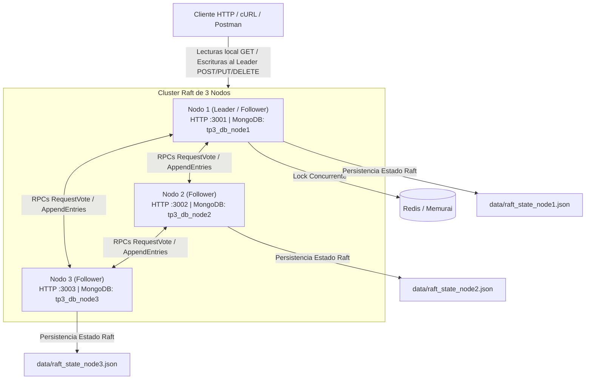

# Trabajo Práctico N° 4: Consenso Distribuido, Paxos y Raft
**Licenciatura en Sistemas de Información — Programación Distribuida**  
**Universidad Champagnat**

---

## 1. Descripción del Proyecto

El **Trabajo Práctico N° 4** hace evolucionar la API REST desarrollada en los trabajos anteriores hacia un **sistema distribuido compuesto por un cluster de 3 nodos independientes (`node1`, `node2`, `node3`)**.

El objetivo es implementar el algoritmo de consenso **Raft**, garantizando acuerdo por mayoría, replicación ordenada de operaciones y tolerancia a fallos ante la caída y recuperación de nodos (*crash/restart*).

### Mapeo de Nodos del Cluster:
- **`node1`**: Puerto HTTP `3001` | MongoDB DB: `tp3_db_node1`
- **`node2`**: Puerto HTTP `3002` | MongoDB DB: `tp3_db_node2`
- **`node3`**: Puerto HTTP `3003` | MongoDB DB: `tp3_db_node3`

---

## 2. Arquitectura del Cluster Raft



---

## 3. Secuencia de Hitos Implementados

- **HITO 1: Cluster e Identidad del Nodo**
  - Identificadores y puertos diferenciados sin modificar código fuente.
  - Endpoint de diagnóstico en `/api/raft/status` o `/raft/status` que expone: `nodeId`, `role`, `currentTerm`, `votedFor`, `leaderId`, `commitIndex`, `lastApplied`, `log`.
- **HITO 2: Elección de Leader mediante Mayoría (Quórum)**
  - Roles: `FOLLOWER`, `CANDIDATE`, `LEADER`.
  - Election timeout aleatorio por nodo (1500ms - 3000ms).
  - RPC `/raft/request-vote` y validación de mayoría ($\ge 2$ de 3 nodos).
- **HITO 3: Heartbeats y Failover**
  - Envío periódico de heartbeats desde el Leader (RPC `/raft/append-entries` cada 300ms).
  - Reseteo de election timers en followers al recibir heartbeats válidos.
  - Re-elección automática ante caídas del Leader.
- **HITO 4: Log Replicado, Consistencia y Commit**
  - Estructura de entrada: `{ index, term, command }`.
  - Validación de antecedente de log (`prevLogIndex`, `prevLogTerm`).
  - Avance del `commitIndex` por mayoría ($\ge 2$ nodos).
- **HITO 5: State Machine e Integración del CRUD REST**
  - State Machine que aplica a MongoDB local solo las entradas `committed`.
  - Rechazo de escrituras recibidas por un Follower con código `409 Conflict` indicando el Leader activo.
  - Convergencia comprobada en las 3 bases de datos MongoDB.
- **HITO 6: Recuperación y Persistencia**
  - **Catch-up:** Sincronización automática de Followers atrasados mediante ajuste dinámico de `nextIndex`.
  - **Persistencia:** Guardado del estado crítico (`currentTerm`, `votedFor`, `log`) en `data/raft_state_<NODE_ID>.json`.
  - **Redis + Raft:** Sección crítica de reserva protegida con Redis Lock y posterior commit en Raft.

---

## 4. Ejecución del Cluster

### Iniciar las 3 instancias del cluster:

Abrir 3 consolas de terminal independientes en el directorio raíz del proyecto:

#### Terminal 1 (`node1`):
```bash
npm run node1
```

#### Terminal 2 (`node2`):
```bash
npm run node2
```

#### Terminal 3 (`node3`):
```bash
npm run node3
```

---

## 5. Endpoints de Diagnóstico y Protocolo Raft

### Diagnóstico de Estado
```bash
# Consultar estado de Node1 (Puerto 3001)
curl http://127.0.0.1:3001/api/raft/status

# Consultar estado de Node2 (Puerto 3002)
curl http://127.0.0.1:3002/api/raft/status

# Consultar estado de Node3 (Puerto 3003)
curl http://127.0.0.1:3003/api/raft/status
```

---

## 6. Secuencia de Pruebas Obligatorias (Escenarios A a I)

| Escenario | Acción | Comportamiento Esperado | Comando de Prueba |
|---|---|---|---|
| **A** | Arranque de los 3 nodos | Se elige 1 Leader y 2 Followers. | `curl http://127.0.0.1:3001/raft/status` |
| **B** | Escritura sobre Follower | La operación es rechazada (409 Conflict) e informa la URL del Leader. | `curl -X POST http://127.0.0.1:3002/api/productos -H "Content-Type: application/json" -d "{\"nombre\":\"Teclado Test\",\"precio\":1000,\"stock\":5}"` |
| **C** | CRUD sobre Leader | Las operaciones confirmadas convergen en los 3 nodos localmente. | `curl -X POST http://127.0.0.1:3001/api/productos -H "Content-Type: application/json" -d "{\"nombre\":\"Teclado Raft\",\"precio\":15000,\"stock\":10}"` |
| **D** | Caída del Leader | Al cerrar el proceso del Leader, los 2 nodos restantes eligen un nuevo Leader. | Detener el proceso del Leader actual y consultar `/raft/status` en los demás. |
| **E** | Quórum 2/3 | Con 1 nodo caído, el cluster de 2 nodos puede seguir confirmando operaciones. | `curl -X POST http://127.0.0.1:3002/api/productos ...` (estando 1 nodo apagado) |
| **F** | Sin Quórum 1/3 | Con 2 nodos caídos, la operación se bloquea o retorna timeout por falta de mayoría. | Detener 2 nodos e intentar escribir en el nodo restante. |
| **G** | Follower Atrasado | Al reencender el nodo caído, recupera las entradas faltantes hasta alinearse. | Reiniciar el nodo previamente apagado y consultar `/raft/status`. |
| **H** | Restart Completo | Tras apagar y reiniciar los 3 nodos, se recupera el término y log persistidos. | Detener los 3 nodos, reiniciarlos y verificar que `log` y `currentTerm` se preservan. |
| **I** | Redis + Raft | Exclusión mutua concurrente con Redis Lock y posterior consenso Raft. | `curl -X POST http://127.0.0.1:3001/api/productos/PROD-001/reservar` |

---

## 7. Respuestas a las Preguntas de Control de Raft

1. **¿Por qué un nodo no debería votar por dos candidatos diferentes dentro del mismo término?**
   - Para garantizar la propiedad de **Liderazgo Único** por término. Si los nodos pudieran votar por múltiples candidatos en el mismo término, dos candidatos diferentes podrían obtener una mayoría simultáneamente, provocando la existencia de dos líderes (*split-brain*) y destruyendo la consistencia de los datos.

2. **¿Qué debería ocurrir si un mensaje recibido contiene un término mayor al término local?**
   - El nodo debe actualizar inmediatamente su término local (`currentTerm = termRecibido`), transicionar a rol **`FOLLOWER`** y resetear su voto (`votedFor = null`). Esto asegura que líderes obsoletos de términos anteriores cedan el control a términos más recientes.

3. **¿Puede un único nodo de un cluster de tres declarar por sí solo que existe consenso?**
   - **No.** En un cluster de 3 nodos, la mayoría (Quórum) requiere al menos $\ge 2$ nodos ($ \lfloor 3/2 \rfloor + 1 = 2 $). Un único nodo representa $1/3$ del cluster, por lo que no alcanza el quórum necesario para declarar un líder ni para confirmar (*commit*) una entrada de log.
