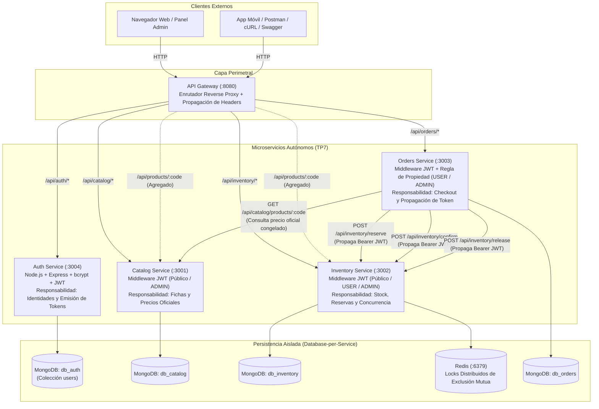

# Trabajo Práctico N° 7: Autenticación, Autorización y Seguridad con JWT
**Licenciatura en Sistemas de Información — Programación Distribuida**  
**Universidad Champagnat — Ciclo Lectivo 2026**

Repositorio grupal único para la evolución de la arquitectura de microservicios: incorporación de mecanismos de identidad, almacenamiento seguro de credenciales con bcrypt, validación distribuida de tokens JWT, control de acceso basado en roles (RBAC) y autorización por propiedad del recurso.

---

## 1. Información General del Proyecto
- **Repositorio Remoto Oficial:** [https://github.com/astorgalucia0-prog/tp5_progdistribuida](https://github.com/astorgalucia0-prog/tp5_progdistribuida)
- **Rama Principal:** `main`
- **Etiqueta de Entrega TP7:** `tp7-entrega`
- **Integrantes del Grupo (Grupo N° 8):**
  - **Astorga, Lucía**
  - **Bustos, Emmanuel**
  - **Lombardo, Damián**
  - **Militello, Santiago**
- **Docentes de la Cátedra:**
  - Adriel Álvarez (`alvarezadriel@uch.edu.ar`)
  - Edgardo Cortez (`cortezedgardo@uch.edu.ar`)

---

## 2. Arquitectura Implementada y Responsabilidades de Seguridad

La arquitectura de microservicios del **TP6** evoluciona incorporando **`auth-service`**, un microservicio especializado y autónomo para la gestión de identidades y emisión de tokens criptográficos, preservando el principio estricto de **Database-per-Service**:



### Tabla de Responsabilidades y Límites de Dominio

| Componente | Puerto Interno | Puerto Host | Persistencia Propia | Responsabilidad Principal | Validación de Seguridad |
| :--- | :---: | :---: | :---: | :--- | :--- |
| **API Gateway** | `8080` | `8080` | N/A | Punto perimetral único, reverse proxy y propagación de headers HTTP `Authorization`. | Pasa tokens transparentemente a microservicios destino |
| **Auth Service** | `3004` | `3004` | `db_auth` (MongoDB) | Alta de identidades, hashing de passwords con bcrypt (12 rounds) y emisión de access tokens JWT. | Autoridad exclusiva sobre credenciales |
| **Catalog Service** | `3001` | `3001` | `db_catalog` (MongoDB) | Catálogo comercial. Lectura pública; creación, edición y borrado restringidos a `ADMIN`. | Middleware `authenticateToken` + `authorizeRoles('ADMIN')` |
| **Inventory Service** | `3002` | `3002` | `db_inventory` (MongoDB) + Redis | Control físico de existencias. Lectura pública; reservas/confirmación autenticadas (`USER`/`ADMIN`); ajustes físicos solo `ADMIN`. | Middleware `authenticateToken` + `authorizeRoles` |
| **Orders Service** | `3003` | `3003` | `db_orders` (MongoDB) | Gestión de compras. Operaciones autenticadas con **control de propiedad del recurso** y propagación de token a Inventario. | Middleware `authenticateToken` + Propiedad (`customer_id == user`) |
| **MongoDB** | `27017` | `27017` | Volumen `mongo_data` | Bases lógicamente aisladas (`db_auth`, `db_catalog`, `db_inventory`, `db_orders`). | Acceso exclusivo por servicio |
| **Redis** | `6379` | `6379` | Volumen `redis_data` | Motor en memoria para locks distribuidos de exclusión mutua en reservas. | Uso interno de Inventory |

---

## 3. Matriz de Endpoints, Autenticación y Autorización (Hitos 1 y 3)

| Microservicio | Método | Endpoint | Acceso | Rol Requerido | Justificación de Negocio |
| :--- | :---: | :--- | :---: | :---: | :--- |
| **auth-service** | `POST` | `/api/auth/register` | **Público** | - | Alta libre de nuevas identidades de usuario. |
| **auth-service** | `POST` | `/api/auth/login` | **Público** | - | Autenticación con credenciales y emisión de token JWT. |
| **auth-service** | `GET` | `/api/auth/me` | **Autenticado** | `USER` / `ADMIN` | Consulta de la identidad autenticada activa vía token. |
| **catalog-service** | `GET` | `/api/catalog/products` | **Público** | - | Navegación del catálogo por visitantes no autenticados. |
| **catalog-service** | `GET` | `/api/catalog/products/:code`| **Público** | - | Consulta de ficha comercial de un producto. |
| **catalog-service** | `GET` | `/api/catalog/categories` | **Público** | - | Listado de rubros y categorías comerciales. |
| **catalog-service** | `POST` | `/api/catalog/products` | **Restringido** | `ADMIN` | Alta de productos comerciales en el catálogo. |
| **catalog-service** | `PUT` | `/api/catalog/products/:code`| **Restringido** | `ADMIN` | Actualización de precios y datos comerciales. |
| **catalog-service** | `DELETE`| `/api/catalog/products/:code`| **Restringido**| `ADMIN` | Baja lógica de productos del catálogo. |
| **inventory-service**| `GET` | `/api/inventory/:code` | **Público** | - | Consulta de existencias físicas disponibles en almacén. |
| **inventory-service**| `POST` | `/api/inventory/reserve` | **Autenticado** | `USER` / `ADMIN` | Reserva atómica temporal asociada a un pedido. |
| **inventory-service**| `POST` | `/api/inventory/confirm` | **Autenticado** | `USER` / `ADMIN` | Deducción definitiva de stock al confirmar compra. |
| **inventory-service**| `POST` | `/api/inventory/release` | **Autenticado** | `USER` / `ADMIN` | Liberación de stock reservado por cancelación. |
| **inventory-service**| `POST` | `/api/inventory/:code/stock` | **Restringido** | `ADMIN` | Ajuste manual de inventario físico en bodega. |
| **orders-service** | `POST` | `/api/orders` | **Autenticado** | `USER` / `ADMIN` | Creación de orden (asociada al `sub`/email del token). |
| **orders-service** | `GET` | `/api/orders/:order_id` | **Autenticado** | `USER` / `ADMIN` | Consulta de orden (**Regla de Propiedad: Solo Dueño o ADMIN**). |
| **orders-service** | `GET` | `/api/orders/customer/:id` | **Autenticado** | `USER` / `ADMIN` | Historial de órdenes (**Regla de Propiedad: Solo Dueño o ADMIN**). |
| **orders-service** | `POST` | `/api/orders/:id/confirm` | **Autenticado** | `USER` / `ADMIN` | Confirmación de orden (**Regla de Propiedad: Solo Dueño o ADMIN**). |
| **orders-service** | `POST` | `/api/orders/:id/cancel` | **Autenticado** | `USER` / `ADMIN` | Cancelación de orden (**Regla de Propiedad: Solo Dueño o ADMIN**). |
| **api-gateway** | `GET` | `/api/products/:code` | **Público** | - | Consulta agregada (Ficha de Catálogo + Stock Inventario). |
| **Todos** | `GET` | `/health`, `/api-docs` | **Público** | - | Chequeos de salud y documentación Swagger/OpenAPI. |

### 3.1 Regla de Autorización por Propiedad del Recurso (Consigna 11.2)
En `orders-service`, no alcanza con tener un token válido. Un usuario con rol `USER` únicamente puede consultar, confirmar o cancelar órdenes cuyo `customer_id` coincida con su identidad autenticada (`email`, `username` o `sub`). Si intenta acceder a una orden ajena, la solicitud se rechaza con **HTTP 403 Forbidden**. Un usuario con rol `ADMIN` posee supervisión global sobre todas las órdenes.

---

## 4. Diferenciación Estricta de Respuestas HTTP (Consigna 11.1 y 18)

| Código HTTP | Significado | Cuándo se Retorna | Ejemplos |
| :---: | :--- | :--- | :--- |
| **400 Bad Request** | Datos inválidos | Cuerpo de la solicitud incompleto o con formato incorrecto. | Falta email o password en login; lista de ítems vacía. |
| **401 Unauthorized** | Identidad ausente o inválida | Falla de autenticación: no existe una identidad válida. | Token ausente, firma inválida, token expirado, credenciales erróneas. |
| **403 Forbidden** | Permisos insuficientes | Identidad válida autenticada, pero sin autorización suficiente. | Usuario `USER` intenta crear producto en catálogo o ver orden ajena. |
| **409 Conflict** | Conflicto de estado/recurso | Regla de unicidad o conflicto de negocio violado. | Intento de registrar un email duplicado; stock insuficiente. |
| **503 Service Unavailable** | Fallo de dependencia | Un servicio descendente o la base de datos no está disponible. | Caída de MongoDB o Inventory no responde al confirmar compra. |

---

## 5. Diseño Criptográfico y Validación Stateless del Token JWT

### 5.1 Estructura del Access Token JWT (HS256)
* **Algoritmo:** HMAC con SHA-256 (`HS256`), configurado con una clave simétrica robusta externalizada (`JWT_SECRET`).
* **Claims estándar incluidos:**
  * `sub`: Identificador único y estable del usuario en base de datos (`ObjectId`).
  * `username`: Nombre de usuario.
  * `email`: Correo electrónico del usuario.
  * `role`: Perfil de autorización (`USER` o `ADMIN`).
  * `iss`: Emisor del token (`uch-distributed-auth`).
  * `iat`: Momento de emisión (UNIX timestamp).
  * `exp`: Momento de vencimiento (configurable vía `JWT_EXPIRES_IN`, ej. `1h`).

### 5.2 Validación Autónoma y Resiliencia ante Caídas (Consigna 12)
* **Principio Stateless:** Cada microservicio protegido (`catalog`, `inventory`, `orders`) verifica localmente en memoria la firma criptográfica y la expiración del JWT utilizando la variable compartida `JWT_SECRET`.
* **Cero Consultas a Base de Datos en Verificación:** No se consulta la base de usuarios en cada petición HTTP, evitando cuellos de botella y acoplamiento temporal.
* **Tolerancia a Fallos:** Si `auth-service` se detiene o reinicia, **los demás microservicios continúan validando tokens emitidos y procesando solicitudes con total normalidad**.

### 5.3 Propagación del Token entre Servicios (Consigna 13)
Cuando un usuario ejecuta un caso de uso inter-servicio (por ejemplo `POST /api/orders` o confirmación de compra), `Orders Service` propaga el encabezado HTTP:
```http
Authorization: Bearer <access-token>
```
hacia los endpoints protegidos de `Inventory Service` (`/reserve`, `/confirm`, `/release`), conservando el contexto de identidad y auditoría a lo largo de toda la traza transaccional.

---

## 6. Variables de Entorno y Configuración Segura (Consignas 14 y 15)

Todas las configuraciones sensibles se encuentran externalizadas en variables de entorno. El archivo `.env` está estrictamente ignorado en `.gitignore`. Se provee una plantilla de referencia en `.env.example`:

| Variable | Valor por Defecto | Descripción |
| :--- | :--- | :--- |
| `NODE_ENV` | `development` / `production` | Entorno de ejecución de Node.js. |
| `JWT_SECRET` | *(Externalizada)* | Clave secreta para firmar y verificar tokens JWT. Nunca se versiona. |
| `JWT_EXPIRES_IN` | `1h` | Vigencia temporal del token (ej: 15m, 1h, 24h). |
| `JWT_ISSUER` | `uch-distributed-auth` | Emisor registrado en el claim `iss`. |
| `BCRYPT_ROUNDS` | `12` | Factor de costo computacional para hashing de contraseñas. |
| `AUTH_SERVICE_PORT` | `3004` | Puerto del microservicio de autenticación. |
| `CATALOG_SERVICE_PORT` | `3001` | Puerto del microservicio de catálogo. |
| `INVENTORY_SERVICE_PORT`| `3002` | Puerto del microservicio de inventario. |
| `ORDERS_SERVICE_PORT` | `3003` | Puerto del microservicio de órdenes. |
| `GATEWAY_PORT` | `8080` | Puerto del API Gateway perimetral. |
| `MONGODB_URI_AUTH` | `mongodb://mongodb:27017/db_auth` | Base de datos exclusiva de identidades. |

---

## 7. Ejecución con Docker Compose

La solución completa con los 5 servicios y persistencia se inicia de forma reproducible mediante un único comando:

### 7.1 Iniciar todos los contenedores
```bash
docker compose up --build -d
```

### 7.2 Verificar el estado y healthchecks
```bash
docker compose ps
```
Todos los contenedores (`tp7-mongodb`, `tp7-redis`, `tp7-auth-service`, `tp7-catalog-service`, `tp7-inventory-service`, `tp7-orders-service`, `tp7-api-gateway`) deben figurar en estado `Up` y `(healthy)`.

### 7.3 Consultar logs de seguridad
```bash
docker compose logs -f auth-service
```

### 7.4 Detener la solución
```bash
# Detiene contenedores conservando datos en volúmenes persistentes
docker compose down

# ATENCIÓN: Elimina contenedores y limpia volúmenes de base de datos
docker compose down -v
```

---

## 8. Documentación Swagger / OpenAPI con Seguridad Bearer (Consigna 16)

Cada microservicio dispone de documentación interactiva OpenAPI 3.0 con esquema `bearerAuth`:

| Microservicio | URL de Swagger UI (Host) | Especificación JSON |
| :--- | :--- | :--- |
| **API Gateway** | `http://localhost:8080/` | - |
| **Auth Service** | `http://localhost:3004/api-docs` | `http://localhost:3004/api-docs.json` |
| **Catalog Service** | `http://localhost:3001/api-docs` | `http://localhost:3001/api-docs.json` |
| **Inventory Service** | `http://localhost:3002/api-docs` | `http://localhost:3002/api-docs.json` |
| **Orders Service** | `http://localhost:3003/api-docs` | `http://localhost:3003/api-docs.json` |

### Cómo probar Swagger con Bearer Token:
1. Abrir `http://localhost:3004/api-docs`.
2. Ejecutar `POST /login` con `admin@uch.edu.ar` / `AdminPassword123!`.
3. Copiar el valor del campo `token`.
4. Abrir cualquier otro Swagger (ej: `http://localhost:3001/api-docs`).
5. Hacer clic en el botón superior **Authorize 🔒**, pegar el token y confirmar.
6. Ahora es posible consumir endpoints restringidos como `POST /products`.

---

## 9. Guía de Uso: Registro, Login y Consumo Autenticado

### 9.1 Registrar un nuevo usuario (`POST /api/auth/register`)
```bash
curl -X POST http://localhost:8080/api/auth/register \
  -H "Content-Type: application/json" \
  -d '{
    "username": "usuario_prueba",
    "email": "usuario@uch.edu.ar",
    "password": "MiPasswordSegura123!",
    "nombre": "Usuario Prueba"
  }'
```

### 9.2 Realizar Login (`POST /api/auth/login`)
```bash
curl -X POST http://localhost:8080/api/auth/login \
  -H "Content-Type: application/json" \
  -d '{
    "email": "usuario@uch.edu.ar",
    "password": "MiPasswordSegura123!"
  }'
```
*Respuesta:*
```json
{
  "token": "eyJhbGciOiJIUzI1NiIsInR5cCI6IkpXVCJ9...",
  "tokenType": "Bearer",
  "expiresIn": "1h",
  "expiresAt": "2026-10-27T22:30:00.000Z",
  "user": {
    "username": "usuario_prueba",
    "email": "usuario@uch.edu.ar",
    "role": "USER",
    "activo": true
  }
}
```

### 9.3 Consumir endpoint protegido con el Token
```bash
# Guardar el token en una variable
TOKEN="eyJhbGciOiJIUzI1NiIsInR5cCI6IkpXVCJ9..."

# Crear una orden autenticada
curl -X POST http://localhost:8080/api/orders \
  -H "Content-Type: application/json" \
  -H "Authorization: Bearer $TOKEN" \
  -d '{
    "items": [
      { "code": "PROD-001", "qty": 1 }
    ]
  }'
```

---

## 10. Batería de Pruebas Obligatorias (Consigna 19 - Escenarios A al L)

Se incluye una suite de pruebas totalmente automatizada que ejecuta y certifica de punta a punta cada uno de los 12 escenarios requeridos por la cátedra:

```bash
# 1. Sembrar identidades iniciales y productos con token ADMIN
npm run seed:tp7

# 2. Ejecutar la suite completa de pruebas de seguridad
npm run test:tp7
```

### Detalle de los 12 Escenarios Validados

| Escenario | Acción Ejecutada | Resultado Comprobado | Estado |
| :---: | :--- | :--- | :---: |
| **A** | Registrar usuario válido mediante `POST /api/auth/register`. | Usuario creado exitosamente (HTTP 201). La respuesta no expone password ni passwordHash. | ✅ OK |
| **B** | Intentar registrar el mismo usuario duplicado. | Rechazo controlado con **HTTP 409 Conflict**. | ✅ OK |
| **C** | Login con credenciales válidas mediante `POST /api/auth/login`. | Respuesta exitosa (HTTP 200) que entrega un JWT con claims `sub`, `email`, `role` y vigencia `exp`. | ✅ OK |
| **D** | Login con password incorrecta. | Rechazo con **HTTP 401 Unauthorized** con mensaje genérico ("Credenciales inválidas"). | ✅ OK |
| **E** | Consumir un endpoint protegido sin enviar token. | Rechazo inmediato con **HTTP 401 Unauthorized** ("Token ausente"). | ✅ OK |
| **F** | Modificar manualmente caracteres de la firma del token. | La firma no valida criptográficamente y responde **HTTP 401 Unauthorized**. | ✅ OK |
| **G** | Utilizar un token JWT emitido con vigencia expirada (`exp` en el pasado). | El middleware detecta expiración y responde **HTTP 401 Unauthorized**. | ✅ OK |
| **H** | Petición con usuario con rol `USER` hacia un endpoint restringido a `ADMIN` (`POST /api/catalog/products`). | Rechazo con **HTTP 403 Forbidden** (permisos insuficientes). | ✅ OK |
| **I** | Petición con usuario con rol `ADMIN` hacia el mismo endpoint protegido. | Operación aceptada y ejecutada exitosamente (HTTP 201 Created). | ✅ OK |
| **J** | Ejecución de caso de uso inter-servicio (Checkout en Orders propagando token a Inventory). | Contexto de identidad conservado; la reserva y confirmación de stock se autorizan correctamente mediante el token propagado. | ✅ OK |
| **K** | Reinicio de la solución y re-autenticación de identidades. | Los usuarios persistidos en volumen MongoDB permanecen intactos y el sistema vuelve a autenticarlos sin error. | ✅ OK |
| **L** | Inspección directa de la base de datos `db_auth` en MongoDB. | Se verifica que el campo `passwordHash` contiene el formato seguro de bcrypt (`$2b$12$...`) y en ningún caso texto plano. | ✅ OK |

---

## 11. Estructura Completa del Repositorio

```text
tp5_progdistribuida/
├── .env.example                    # Plantilla de variables de entorno con configuración JWT
├── .gitignore                      # Exclusión estricta de .env, node_modules y logs
├── docker-compose.yml              # Orquestador con 5 microservicios, MongoDB y Redis
├── package.json                    # Scripts del proyecto (seed:tp7, test:tp7, compose)
├── README.md                       # Documentación integral del TP7
├── docs/                           # Documentación de arquitectura previa (TP5/TP6)
├── scripts/
│   ├── seed-tp7.js                 # Inicializador autenticado de identidades y catálogo
│   ├── test-tp7-security.js        # Suite de pruebas automatizadas para escenarios A al L
│   ├── seed-tp6.js                 # Semillero histórico TP6
│   └── test-e2e.js                 # Pruebas históricas E2E TP6
└── services/
    ├── api-gateway/                # Capa Perimetral HTTP (:8080)
    │   ├── Dockerfile
    │   ├── package.json
    │   └── src/ (app.js, server.js, config, logger)
    ├── auth-service/               # Microservicio de Identidad y Autenticación JWT (:3004)
    │   ├── Dockerfile
    │   ├── package.json
    │   └── src/ (models/User.js, services/authService.js, controllers, routes, middlewares, swagger)
    ├── catalog-service/            # Microservicio de Catálogo Comercial (:3001)
    │   ├── Dockerfile
    │   ├── package.json
    │   └── src/ (middlewares/auth.js, controllers, routes, services, swagger, app.js, server.js)
    ├── inventory-service/          # Microservicio de Inventario y Concurrencia (:3002)
    │   ├── Dockerfile
    │   ├── package.json
    │   └── src/ (middlewares/auth.js, controllers, routes, services, swagger, redis.js, app.js, server.js)
    └── orders-service/             # Microservicio de Órdenes y Checkout (:3003)
        ├── Dockerfile
        ├── package.json
        └── src/ (middlewares/auth.js, clients/inventoryClient.js, controllers, routes, services, swagger)
```
