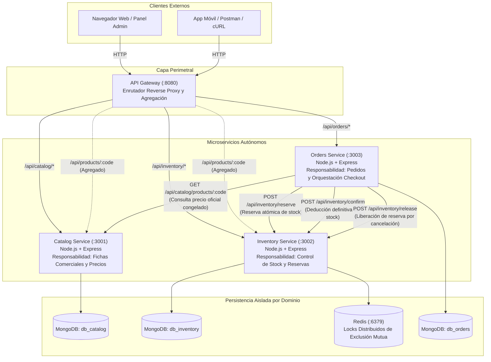

# Trabajo Práctico N° 6: Implementación de Microservicios y Docker
**Licenciatura en Sistemas de Información — Programación Distribuida**  
**Universidad Champagnat — Ciclo Lectivo 2026**

Repositorio grupal único para la evolución de la arquitectura desde el monolito distribuido hacia una solución de microservicios contenerizada con Docker y Docker Compose.

---

## 1. Información General del Proyecto
- **Repositorio Remoto Oficial:** [https://github.com/astorgalucia0-prog/tp5_progdistribuida](https://github.com/astorgalucia0-prog/tp5_progdistribuida)
- **Rama Principal:** `main`
- **Etiqueta de Entrega TP6:** `tp6-entrega`
- **Integrantes del Grupo (Grupo N° 8):**
  - **Astorga, Lucía**
  - **Bustos, Emmanuel**
  - **Lombardo, Damián**
  - **Militello, Santiago**
- **Docentes de la Cátedra:**
  - Adriel Álvarez (`alvarezadriel@uch.edu.ar`)
  - Edgardo Cortez (`cortezedgardo@uch.edu.ar`)

---

## 2. Arquitectura Implementada y Responsabilidades

El sistema implementa de forma ejecutable la arquitectura definida en el **TP5**, bajo el principio estricto de **Database-per-Service**:



### Tabla de Responsabilidades y Límites de Dominio

| Componente | Puerto Interno | Puerto Host | Persistencia Propia | Responsabilidad Principal | Dependencias |
| :--- | :---: | :---: | :---: | :--- | :--- |
| **API Gateway** | `8080` | `8080` | N/A | Punto de entrada perimetral, reverse proxy por prefijo de ruta y agregación liviana de consultas. | `catalog-service`, `inventory-service`, `orders-service` |
| **Catalog Service** | `3001` | `3001` | `db_catalog` (MongoDB) | Único dueño de artículos comerciales, categorías y precios de lista oficiales. No almacena ni manipula stock. | Ninguna (Servicio Hoja) |
| **Inventory Service** | `3002` | `3002` | `db_inventory` (MongoDB) + Redis | Control físico de existencias, reservas atómicas temporales (TTL), deducción y liberación con exclusión mutua distribuida. | `redis` (interno para locks) |
| **Orders Service** | `3003` | `3003` | `db_orders` (MongoDB) | Orquestación del proceso de compra, congelamiento contractual de precios, gestión transaccional del ciclo de vida de pedidos. | `catalog-service`, `inventory-service` |
| **MongoDB** | `27017` | `27017` | Volumen `mongo_data` | Motor de base de datos no relacional que aloja las bases lógicamente independientes de cada microservicio. | Ninguna |
| **Redis** | `6379` | `6379` | Volumen `redis_data` | Motor en memoria para sección crítica y locks distribuidos de exclusión mutua en reservas de stock. | Ninguna |

---

## 3. Requisitos de Software y Verificación de Docker

### Requisitos
- **Node.js:** Versión 20.x o 22.x LTS (se utiliza `fetch` nativo para comunicación HTTP).
- **Docker & Docker Compose:** Docker Engine 24+ / Docker Desktop con backend WSL 2 en Windows.
- **Git:** Para clonar el repositorio y gestionar ramas.

### Verificación de Instalación de Docker (Consigna 5)
Ejecutar en la terminal:
```bash
wsl --status              # En Windows con WSL 2
docker --version          # Verificación de Docker CLI (ej: 29.7.2)
docker compose version    # Verificación de Docker Compose (ej: v5.3.1)
docker info               # Diagnóstico de daemon y contexto
docker run --rm hello-world # Ejecución correcta de contenedor de prueba
```

---

## 4. Ejecución del Entorno Completo con Docker Compose

La solución completa se construye e inicia mediante un **único comando**:

### 4.1 Iniciar la solución
```bash
docker compose up --build -d
```

### 4.2 Verificar el estado de los contenedores
```bash
docker compose ps
```
Todos los contenedores (`tp6-mongodb`, `tp6-redis`, `tp6-catalog-service`, `tp6-inventory-service`, `tp6-orders-service`, `tp6-api-gateway`) deben mostrarse en estado `Up` y `(healthy)`.

### 4.3 Consultar logs en tiempo real
```bash
# Logs consolidados de todos los servicios
docker compose logs -f

# Logs de un servicio específico
docker compose logs -f orders-service
docker compose logs -f inventory-service
```

### 4.4 Detener el entorno
```bash
# Detiene y remueve los contenedores conservando los datos en volúmenes persistentes
docker compose down

# ATENCIÓN: Elimina contenedores y además borra los volúmenes de base de datos
docker compose down -v
```

---

## 5. Nombres DNS Internos y Comunicación Inter-Servicios

Dentro de la red interna bridge de Docker (`microservices-net`), los microservicios se comunican resolviendo los nombres declarados en `docker-compose.yml`:

| Origen | Destino | URL Interna en Red Docker | Propósito |
| :--- | :--- | :--- | :--- |
| `orders-service` | `catalog-service` | `http://catalog-service:3001` | Consulta de existencia de producto y precio oficial de venta |
| `orders-service` | `inventory-service` | `http://inventory-service:3002` | Solicitud atómica de reserva, confirmación o liberación de stock |
| `inventory-service`| `redis` | `redis://redis:6379` | Adquisición y liberación de locks de exclusión mutua (`SET NX PX`) |
| Microservicios | `mongodb` | `mongodb://mongodb:27017/<base_propia>` | Conexión a la persistencia exclusiva de cada dominio |
| `api-gateway` | Microservicios | `http://<servicio>:<puerto-interno>` | Reenvío perimetral de solicitudes de clientes |

> **Principio de Aislamiento:** Dentro de un contenedor `localhost` apunta a sí mismo. Por ello, la comunicación entre contenedores utiliza el nombre DNS del servicio de destino y su puerto interno, nunca `localhost`.

---

## 6. URLs de Swagger UI y Endpoints de Salud (Health Checks)

Cada microservicio expone su documentación interactiva OpenAPI y su endpoint de monitoreo de disponibilidad:

| Microservicio | Swagger UI (Host) | Health Check | Respuesta de Health Check |
| :--- | :--- | :--- | :--- |
| **API Gateway** | `http://localhost:8080/` | `http://localhost:8080/health` | Estado del Gateway y conectividad hacia los 3 microservicios |
| **Catalog Service** | `http://localhost:3001/api-docs` | `http://localhost:3001/health` | `{ "service": "catalog-service", "status": "ok", "dependencies": { "mongodb": "connected" } }` |
| **Inventory Service** | `http://localhost:3002/api-docs` | `http://localhost:3002/health` | `{ "service": "inventory-service", "status": "ok", "dependencies": { "mongodb": "connected", "redis": "connected" } }` |
| **Orders Service** | `http://localhost:3003/api-docs` | `http://localhost:3003/health` | `{ "service": "orders-service", "status": "ok", "dependencies": { "mongodb": "connected" } }` |

---

## 7. Procedimiento de Pruebas Obligatorias (Sección 18)

### 7.1 Carga Inicial de Datos de Prueba Reproducibles (Seed)
Para poblar el catálogo e inventario con un estado conocido de prueba:
```bash
npm run seed
# O directamente:
node scripts/seed-tp6.js
```
Esto inicializa los artículos `PROD-001` (10 unidades), `PROD-002` (5 unidades), `PROD-003` (3 unidades) y `PROD-004` (15 unidades).

### 7.2 Ejecución de la Suite de Pruebas Automatizada (E2E)
Se dispone de un script que valida el 100% de los requisitos funcionales de comunicación, concurrencia y manejo de errores:
```bash
npm run test:e2e
# O directamente:
node scripts/test-e2e.js
```
El script ejecuta y verifica:
1. Health check del API Gateway y servicios.
2. Consulta de catálogo comercial (`GET /api/catalog/products`).
3. Consulta de existencias físicas (`GET /api/inventory/PROD-001`).
4. Endpoint compuesto en Gateway (`GET /api/products/PROD-001`).
5. Creación de orden con reserva atómica (`POST /api/orders` -> estado `PENDING` y `reservation_id` asignado).
6. Confirmación de orden y deducción definitiva de stock (`POST /api/orders/:id/confirm` -> estado `CONFIRMED`).
7. Control de conflicto de negocio por stock insuficiente (solicitar 999999 unidades responde controladamente `409 Conflict`, no 500).

---

## 8. Comunicación y Manejo de Fallos (Consigna 15)

### 8.1 Cliente HTTP y Resiliencia en `Orders Service`
El cliente HTTP de `Orders Service` (`src/clients/`) implementa:
- **Timeouts explícitos:** Todas las peticiones remotas utilizan `AbortSignal.timeout(3000)` para evitar demoras o bloqueos indefinidos.
- **Semántica de errores HTTP:**
  - `404 Not Found` remoto: Se trata como error de negocio/funcional (producto inexistente). No se convierte en 503.
  - `409 Conflict` remoto: Se propaga como conflicto de negocio (stock insuficiente).
  - `Fallo de conexión / Timeout / ECONNREFUSED`: Se captura la excepción y se retorna al cliente `503 Service Unavailable`, identificando en logs el servicio de origen (`orders-service`), la dependencia remota (`inventory-service` o `catalog-service`) y la causa del fallo.

### 8.2 Prueba de Indisponibilidad (Paso a Paso)
Para comprobar la tolerancia a fallos ante la caída de un servicio dependiente:
1. **Verificar solución arriba:** Realizar una orden exitosa.
2. **Detener el servicio destino:**
   ```bash
   docker compose stop inventory-service
   ```
3. **Repetir la creación de la orden:**
   ```bash
   curl -X POST http://localhost:8080/api/orders \
     -H "Content-Type: application/json" \
     -d "{\"customer_id\": \"CLI-TEST\", \"items\": [{\"code\": \"PROD-001\", \"qty\": 1}]}"
   ```
4. **Verificar respuesta controlada:** `orders-service` **no colapsa ni finaliza inesperadamente**. Responde HTTP `503 Service Unavailable`:
   ```json
   {
     "service": "orders-service",
     "error": "ServiceUnavailable",
     "message": "Inventory Service no se encuentra disponible temporalmente (Fallo de conexión).",
     "statusCode": 503,
     "remoteService": "inventory-service"
   }
   ```
5. **Restaurar el servicio:**
   ```bash
   docker compose start inventory-service
   ```
6. **Comprobar recuperación:** Volver a emitir la orden y verificar que la operación se procesa con éxito (`201 Created`).

---

## 9. Análisis de Fallos Parciales en Operaciones Distribuidas (Sección 15.3)

En una arquitectura de microservicios, una transacción de negocio involucra múltiples etapas y bases de datos independientes. Se analiza el caso de uso principal: **"Creación y Checkout de Orden"**.

### 1. Etapas y orden de operaciones
1. `Orders Service` consulta `Catalog Service` para obtener el precio oficial vigente del producto.
2. `Orders Service` solicita a `Inventory Service` una reserva atómica temporal de unidades (`POST /api/inventory/reserve`).
3. `Inventory Service` adquiere el lock en Redis, descuenta del stock disponible e incrementa el stock reservado, devolviendo `reservation_id`.
4. `Orders Service` persiste la orden en `db_orders` en estado `PENDING`.
5. El cliente realiza el pago y se solicita confirmación (`POST /api/orders/:id/confirm`).
6. `Orders Service` solicita la confirmación de deducción definitiva a `Inventory Service` (`POST /api/inventory/confirm`).

### 2. Cambios de estado por etapa
- Etapa 3: `stock_disponible -= qty`, `stock_reservado += qty` en `db_inventory`.
- Etapa 4: Orden creada con estado `PENDING` en `db_orders`.
- Etapa 6: `stock_reservado -= qty`, `stock_total -= qty` en `db_inventory`, y orden pasa a `CONFIRMED` en `db_orders`.

### 3. Qué sucede si falla una etapa posterior a una ya confirmada
- **Escenario A (Falla Etapa 4):** La reserva de stock en inventario se confirmó (Etapa 3), pero se corta la conexión o cae la base de datos de órdenes antes de guardar el pedido. El stock queda bloqueado como reservado en inventario, pero no existe orden asociada en `Orders Service`.
- **Escenario B (Falla Etapa 6):** El cliente abonó su orden, pero la llamada a `POST /api/inventory/confirm` falla por timeout o caída temporal de red. La orden podría figurar confirmada o pendiente de confirmación mientras el stock sigue figurando como reservado y no liquidado definitivamente.

### 4. ¿Puede quedar el sistema en estado inconsistente?
**Sí.** Se produce una inconsistencia eventual donde existencias físicas quedan "congeladas" en el almacén impidiendo que otros clientes las compren (*stock fantasma*).

### 5. Mecanismos de mitigación y compensación implementados y futuros
1. **TTL de Reservas (Implementado):** Toda reserva en `Inventory Service` cuenta con un campo `expira_at` (10 minutos por defecto). Pasado este tiempo, las reservas que no fueron confirmadas pueden ser liberadas automáticamente devolviendo las unidades al stock disponible.
2. **Endpoint de Liberación / Rollback (Implementado):** Ante una falla o cancelación del usuario, `Orders Service` invoca `POST /api/inventory/release` para devolver inmediatamente las existencias sin esperar la expiración del TTL.
3. **Evolución Futura (Patrón Saga / Outbox):** En una etapa productiva avanzada, se implementaría una **Saga Orquestada** o coreografiada con eventos asíncronos (RabbitMQ / Kafka) y un proceso *Reconciliador en segundo plano* que verifique periódicamente órdenes en estado pendiente vs. reservas huérfanas en inventario para aplicar transacciones compensatorias automáticas.

---

## 10. Persistencia y Explicación de Volúmenes

Para garantizar que los datos sobrevivan a la detención y actualización de los contenedores, `docker-compose.yml` define volúmenes nombrados:

```yaml
volumes:
  mongo_data:
    driver: local
  redis_data:
    driver: local
```

### Demostración del ciclo de vida de los datos:
1. Crear un producto o una orden.
2. Detener los contenedores con `docker compose down`.
3. Volver a levantarlos con `docker compose up -d`.
4. Consultar los datos: continúan disponibles sin alteración.
5. Únicamente si se ejecuta explícitamente `docker compose down -v`, Docker destruirá los volúmenes nombrados `mongo_data` y `redis_data`, reiniciando el estado de la base de datos a limpio.

---

## 11. Diferencias de Configuración: Local vs. Docker Compose

El mismo código fuente se ejecuta de forma directa con Node.js o dentro de contenedores Docker sin alterar una sola línea de lógica, adaptándose mediante variables de entorno:

| Variable | Ejecución Directa (Local Node.js) | Ejecución Docker Compose |
| :--- | :--- | :--- |
| `HOST` | `127.0.0.1` | `0.0.0.0` |
| `MONGODB_URI` (Catalog) | `mongodb://127.0.0.1:27017/db_catalog` | `mongodb://mongodb:27017/db_catalog` |
| `MONGODB_URI` (Inventory) | `mongodb://127.0.0.1:27017/db_inventory` | `mongodb://mongodb:27017/db_inventory` |
| `MONGODB_URI` (Orders) | `mongodb://127.0.0.1:27017/db_orders` | `mongodb://mongodb:27017/db_orders` |
| `REDIS_URL` | `redis://127.0.0.1:6379` | `redis://redis:6379` |
| `CATALOG_SERVICE_URL` | `http://127.0.0.1:3001` | `http://catalog-service:3001` |
| `INVENTORY_SERVICE_URL` | `http://127.0.0.1:3002` | `http://inventory-service:3002` |
| `ORDERS_SERVICE_URL` | `http://127.0.0.1:3003` | `http://orders-service:3003` |

---

## 12. Estructura del Proyecto

```text
tp5_progdistribuida/
├── docker-compose.yml              # Orquestador Compose con redes, volúmenes y healthchecks
├── package.json                    # Scripts auxiliares raíz (test:e2e, seed, compose)
├── README.md                       # Documentación exhaustiva del TP6
├── docs/                           # Documentación de arquitectura previa (TP5)
├── scripts/
│   ├── seed-tp6.js                 # Semillero reproducible de prueba
│   └── test-e2e.js                 # Suite de pruebas automatizadas E2E
└── services/
    ├── api-gateway/                # Gateway perimetral HTTP (:8080)
    │   ├── Dockerfile
    │   ├── .dockerignore
    │   ├── package.json
    │   └── src/ (app.js, server.js, config, logger)
    ├── catalog-service/            # Microservicio de Catálogo Comercial (:3001)
    │   ├── Dockerfile
    │   ├── .dockerignore
    │   ├── package.json
    │   └── src/ (controllers, routes, services, models, swagger, app.js, server.js)
    ├── inventory-service/          # Microservicio de Inventario y Concurrencia (:3002)
    │   ├── Dockerfile
    │   ├── .dockerignore
    │   ├── package.json
    │   └── src/ (controllers, routes, services, models, redis.js, swagger, app.js, server.js)
    └── orders-service/             # Microservicio de Órdenes y Checkout (:3003)
        ├── Dockerfile
        ├── .dockerignore
        ├── package.json
        └── src/ (controllers, routes, services, clients, models, swagger, app.js, server.js)
```
