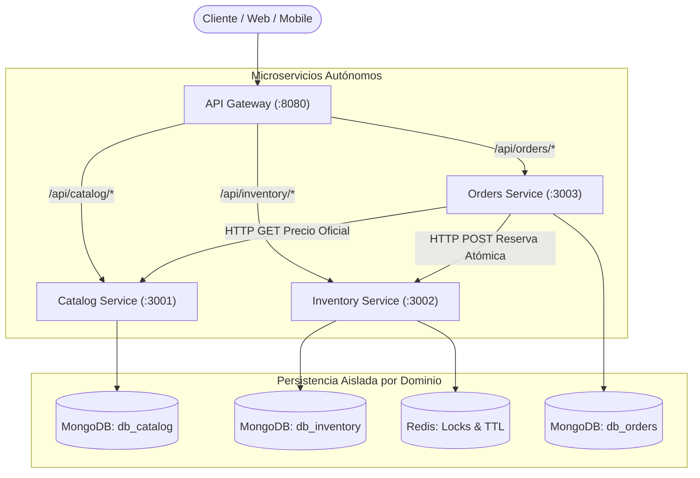

# Proyecto Distribuido: De API REST a Microservicios
**Licenciatura en Sistemas de Información — Programación Distribuida**  
**Universidad Champagnat**

Repositorio base y evolutivo único para el desarrollo de trabajos prácticos de la cátedra de Programación Distribuida.

---

## 1. Información General del Repositorio
- **Repositorio Remoto Oficial:** [https://github.com/astorgalucia0-prog/tp5_progdistribuida](https://github.com/astorgalucia0-prog/tp5_progdistribuida)
- **Rama Principal:** `main`
- **Rama de Trabajo de Arquitectura:** `docs/arquitectura`
- **Etiqueta de Entrega TP5:** `tp5-entrega`
- **Docentes Colaboradores:**
  - Adriel Álvarez (`alvarezadriel@uch.edu.ar`)
  - Edgardo Cortez (`cortezedgardo@uch.edu.ar`)

---

## 2. Estructura del Repositorio (Consigna 13)

```text
tp5_progdistribuida/
├── docs/
│   ├── arquitectura.md              # Documento central de arquitectura, inventario y análisis
│   └── diagrama-arquitectura.md     # Especificación visual y diagramas de flujo Mermaid
├── services/                        # Scaffolding de microservicios independientes
│   ├── api-gateway/                 # Gateway perimetral de enrutamiento (:8080)
│   ├── catalog-service/             # Catálogo de productos y precios (:3001)
│   ├── inventory-service/           # Control de stock y reservas con Redis (:3002)
│   └── orders-service/              # Gestión de compras y ciclo de vida de pedidos (:3003)
├── src/                             # Aplicación base funcional de partida (Monolito TP4 con Raft)
│   ├── raft/                        # Submódulos del protocolo Raft
│   ├── endpoints.js                 # Rutas de la API original
│   ├── database.js                  # Conexión MongoDB original
│   ├── redis.js                     # Conexión y Locks Redis
│   └── service.js                   # Servidor Express original
├── public/                          # Dashboard web estático de pruebas
├── scripts/                         # Scripts de ejecución de nodos
├── .env.example                     # Plantilla de variables de entorno documentada
├── .gitignore                       # Blindaje estricto de dependencias y secretos
├── generate_pdf_tp5.py              # Generador de informe académico oficial en PDF (TP5)
├── package.json                     # Manifiesto de dependencias
└── README.md                        # Documentación principal
```

---

## 3. Arquitectura Propuesta de Microservicios (TP5)

El sistema evoluciona desde una API monolítica hacia una arquitectura desacoplada basada en el principio **Database-per-Service**:



### Mapa de Puertos y Servicios
| Componente | Puerto | Base de Datos | Responsabilidad Principal |
| :--- | :---: | :---: | :--- |
| **API Gateway** | `8080` | N/A | Punto de entrada perimetral y enrutamiento hacia microservicios. |
| **Catalog Service** | `3001` | `db_catalog` | Catálogo de artículos, fichas técnicas, categorías y precios de lista. |
| **Inventory Service** | `3002` | `db_inventory` + Redis | Control de existencias físicas, reservas atómicas y disponibilidad. |
| **Orders Service** | `3003` | `db_orders` | Creación de pedidos, cálculo de totales y coordinación de compras. |
| **Monolito Base (TP4)** | `3001-3003` | `tp3_db_nodeX` | Cluster de consenso Raft previo utilizado como versión de partida. |

---

## 4. Documentación de Arquitectura

Para consultar el análisis detallado del relevamiento, acoplamientos, matrices de propiedad y trazado de casos de uso, referirse a:
- [docs/arquitectura.md](file:///c:/Users/Usuario/Desktop/Prog-%20Distribuida/docs/arquitectura.md)
  - *Sección 5:* Inventario de funcionalidades y endpoints existentes.
  - *Sección 6:* Identificación de responsabilidades funcionales (8 preguntas de diseño).
  - *Sección 7:* Identificación de acoplamientos y matriz de desacople.
  - *Sección 8:* Fichas de definición de cada microservicio y tabla general.
  - *Sección 9:* Matriz de propiedad de datos (Database-per-Service).
  - *Sección 10:* Matriz de comunicación inter-servicio y trazado de casos de uso.
  - *Sección 11:* Diagrama de arquitectura del sistema.
  - *Sección 12:* Validación de límites propuestos (Checklist).

---

## 5. Flujo de Trabajo con Git y Colaboración

1. **Ramas:** No se desarrolla directamente sobre `main`. Todo cambio se realiza en ramas por funcionalidad (`feature/...`, `docs/...`, `fix/...`) y se integra vía Pull Request.
2. **Commits Claros:** Mensajes estructurados (`feat:`, `docs:`, `fix:`) que explican el motivo del cambio.
3. **Identificación de Entregas:** Las entregas formales se congelan con tags de Git (`git tag tp5-entrega`).
