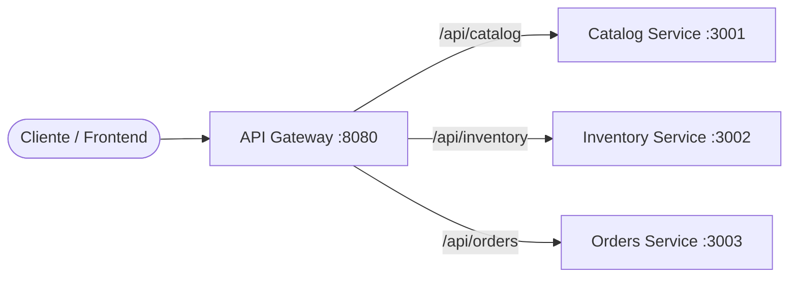
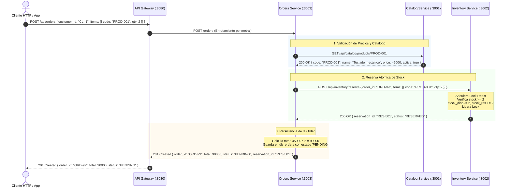
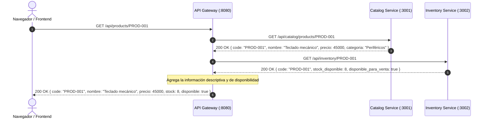

# Trabajo Práctico N° 5: De API REST a Microservicios
**Licenciatura en Sistemas de Información — Programación Distribuida**  
**Universidad Champagnat**

---

## Información del Proyecto
- **Repositorio Remoto Único:** [https://github.com/astorgalucia0-prog/tp5_progdistribuida](https://github.com/astorgalucia0-prog/tp5_progdistribuida)
- **Rama Principal:** `main`
- **Rama de Trabajo:** `docs/arquitectura`
- **Docentes de la Cátedra incorporados:**
  - Adriel Álvarez (`alvarezadriel@uch.edu.ar`)
  - Edgardo Cortez (`cortezedgardo@uch.edu.ar`)
- **Versión Funcional de Partida:** API REST Distribuida con Consenso Raft (3 nodos), Exclusión Mutua con Redis Lock y Persistencia Mongoose (TP4).

---

## 5. Análisis de la Aplicación Existente

### 5.1 Relevamiento de Componentes y Recursos Actuales
La aplicación base sobre la que se realiza la evolución corresponde a una API REST monolítica distribuida desarrollada para la gestión de productos y accesorios tecnológicos.

- **Entidades Principales:**
  - `Producto`: Representa un artículo en catálogo y a la vez su inventario físico (`codigo`, `nombre`, `precio`, `stock`, `categoria`, `descripcion`).
  - `RaftState / Entry`: Representa el estado del algoritmo de consenso distribuido persistido en archivos JSON locales (`term`, `votedFor`, `log`).
  - `RedisLock`: Recurso en memoria utilizado como sección crítica para exclusión mutua distribuida (`lock:producto:<id>`).
- **Módulos y Controladores Involucrados:**
  - `src/service.js`: Servidor Express principal, configuración de puertos HTTP/HTTPS, Swagger UI y logging centralizado con Winston.
  - `src/endpoints.js`: Enrutador de operaciones CRUD sobre productos y reservas con lógica de verificación Raft y Redis.
  - `src/models/Producto.js`: Definición de esquema y validaciones con Mongoose.
  - `src/redis.js`: Abstracción de conexión y funciones de lock distribuido (`acquireLock`, `releaseLock`).
  - `src/database.js`: Administrador de ciclo de vida de conexión con MongoDB.
  - `src/raft/`: Submódulos del protocolo Raft (`raftNode.js`, `raftRouter.js`, `raftPersistence.js`, `stateMachine.js`, `nodeConfig.js`).
- **Acceso a Persistencia:**
  - Todos los endpoints de negocio operan sobre la misma base de datos MongoDB compartida (`tp3_distribuida` o `tp3_db_nodeX`), sin segmentación por contexto de dominio.

### 5.2 Inventario Inicial de Funcionalidades y Endpoints

| Funcionalidad / Endpoint | Responsabilidad Actual | Datos Utilizados | Dependencias |
| :--- | :--- | :--- | :--- |
| **GET /api** | Informa el estado general del nodo, conectividad con base de datos y estado de consenso Raft. | `nodeId`, `role`, estado de conexión MongoDB, estado de conexión Redis, timestamp. | `raftNode`, `database.js`, `redis.js`. |
| **GET /api/productos** (o `/accesorios`) | Recupera la lista completa de artículos para visualización en el catálogo; ejecuta semillero inicial si la base está vacía. | Colección `productos` de MongoDB (`_id`, `codigo`, `nombre`, `precio`, `stock`, `categoria`, `descripcion`). | `Producto` (Mongoose), `database.js`. |
| **GET /api/productos/:id** (o `/accesorios/:id`) | Busca y retorna la ficha individual de un producto mediante su `ObjectId` o código de catálogo (`PROD-XXX`). | Parámetro `id` o `codigo`, documento en MongoDB. | `Producto` (Mongoose), `database.js`. |
| **POST /api/productos** (o `/accesorios`) | Valida datos de entrada y propone una entrada en el log replicado de Raft (solo si el nodo es Líder). | `codigo`, `nombre`, `precio`, `stock`, `categoria`, `descripcion`. | `Producto`, `raftNode.proposeCommand()`, MongoDB. |
| **PUT /api/productos/:id** (o `/accesorios/:id`) | Propone la modificación de atributos descriptivos y/o de stock en el cluster Raft. | Parámetro `id`, campos modificados en `req.body`. | `Producto`, `raftNode.proposeCommand()`, MongoDB. |
| **DELETE /api/productos/:id** (o `/accesorios/:id`) | Propone la eliminación física del artículo por consenso de mayoría en Raft. | Parámetro `id` / `codigo`. | `Producto`, `raftNode.proposeCommand()`, MongoDB. |
| **POST /api/productos/:id/reservar** | Adquiere un lock temporal en Redis, propone el decremento de stock por consenso Raft y libera el lock. | `id` del producto, clave de lock `lock:producto:<id>`, `stock`. | `redis.js` (`acquireLock`, `releaseLock`), `raftNode`, `Producto` en MongoDB. |
| **GET /raft/status** | Expone métricas de diagnóstico del nodo para observabilidad del protocolo Raft. | `nodeId`, `role`, `currentTerm`, `votedFor`, `leaderId`, `commitIndex`, `lastApplied`, `log`. | `raftNode`. |
| **POST /raft/request-vote** | RPC de protocolo para solicitud de votos durante elecciones de Líder. | `term`, `candidateId`, `lastLogIndex`, `lastLogTerm`. | `raftNode`. |
| **POST /raft/append-entries** | RPC de protocolo para replicación de logs y latidos (*heartbeats*). | `term`, `leaderId`, `prevLogIndex`, `prevLogTerm`, `entries`, `leaderCommit`. | `raftNode`, `stateMachine.js`. |

---

## 6. Identificación de Responsabilidades Funcionales

A partir del inventario anterior, se agrupan las funcionalidades según su verdadera responsabilidad de negocio en **tres áreas funcionales**:

### Grupo Funcional A: Gestión de Catálogo y Datos Comerciales
Agrupa las funcionalidades relacionadas con la publicación, mantenimiento y consulta de las fichas comerciales de los artículos.

1. **¿Qué problema o necesidad del sistema resuelve?**
   Permite que los usuarios consulten y administren la información comercial de los productos disponibles (nombres, descripciones, categorías, precios de venta), sirviendo de base para la navegación de la tienda.
2. **¿Qué operaciones realiza?**
   Alta de nuevos artículos, edición de nombres, categorías, fichas técnicas y precios, bajas de artículos obsoletos, listado paginado y búsqueda por identificador comercial o código.
3. **¿Qué reglas de negocio contiene?**
   - El código de producto debe ser único y normalizado en mayúsculas.
   - El precio de venta no puede ser negativo.
   - El nombre comercial debe tener un mínimo de 2 caracteres.
   - Todo producto debe pertenecer a una categoría definida (o default "Otros").
4. **¿Qué información necesita para trabajar?**
   Datos descriptivos del producto: código, nombre, categoría, descripción, precio sugerido.
5. **¿Qué información crea o modifica?**
   Crea y actualiza registros en la base de datos de catálogo comercial.
6. **¿Qué otras funcionalidades necesita conocer?**
   No requiere conocer la existencia de existencias físicas en bodega ni la infraestructura de pagos o pedidos para publicar su información descriptiva.
7. **¿Qué cambios funcionales suelen ocurrir juntos?**
   Cambios de temporada, actualización masiva de precios, modificación de categorías o incorporación de nuevas características de producto (especificaciones técnicas).
8. **¿Podría evolucionar de manera independiente del resto de la aplicación?**
   **Sí.** El catálogo tiene un patrón de acceso principalmente de lectura masiva (Read-Heavy), con requerimientos de indexación textual y cacheo muy diferentes a los del stock físico o pedidos.

---

### Grupo Funcional B: Control de Inventario, Existencias y Reservas
Agrupa las funcionalidades vinculadas al conteo de unidades físicas en almacén, validación de disponibilidad y reservas operativas.

1. **¿Qué problema o necesidad del sistema resuelve?**
   Evita la sobreventa (*overselling*) de mercadería garantizando que solo se puedan reservar o despachar unidades efectivamente disponibles en stock.
2. **¿Qué operaciones realiza?**
   Consulta de existencias físicas disponibles, ingreso de stock por reposición, reserva de unidades para una compra en curso, liberación de reservas caducadas y deducción definitiva de stock.
3. **¿Qué reglas de negocio contiene?**
   - El stock no puede ser negativo bajo ninguna circunstancia.
   - Toda reserva temporal exige exclusión mutua para evitar condiciones de carrera (*race conditions*) en escenarios de alta concurrencia.
   - El stock debe ser estrictamente un número entero mayor o igual a cero.
4. **¿Qué información necesita para trabajar?**
   Identificador único del producto (`codigo`), cantidad solicitada, identificador de la reserva/transacción.
5. **¿Qué información crea o modifica?**
   Stock total, stock disponible, stock reservado y marcas temporales de reservas.
6. **¿Qué otras funcionalidades necesita conocer?**
   Únicamente el identificador comercial del producto para correlacionar las existencias; no necesita conocer el nombre, descripción ni imagen del producto.
7. **¿Qué cambios funcionales suelen ocurrir juntos?**
   Políticas de umbrales mínimos de reposición, reglas de vencimiento de reservas temporales, integración con lectores de almacén o WMS.
8. **¿Podría evolucionar de manera independiente del resto de la aplicación?**
   **Sí.** Tiene un perfil transaccional de alta tasa de escrituras críticas y requiere mecanismos especializados de concurrencia y bloqueo que no deben afectar la navegación del catálogo.

---

### Grupo Funcional C: Gestión de Órdenes y Pedidos de Clientes
Agrupa la orquestación del flujo de compra: consolidación de artículos solicitados por un cliente, verificación de precios con catálogo y aseguramiento de existencias con inventario.

1. **¿Qué problema o necesidad del sistema resuelve?**
   Permite a los clientes agrupar artículos, formalizar una intención de compra, registrar la trazabilidad de la orden y coordinar las validaciones previas a la confirmación de la venta.
2. **¿Qué operaciones realiza?**
   Creación de orden, adición de líneas de pedido, cálculo de total a pagar, coordinación de reserva de existencias y cambio de estados (Pendiente, Confirmada, Cancelada, Despachada).
3. **¿Qué reglas de negocio contiene?**
   - Una orden debe contener al menos un producto con cantidad mayor a cero.
   - El precio unitario debe fijarse al momento de crear la orden (inmutabilidad de precio acordado).
   - Para confirmarse, debe haber obtenido reserva positiva de stock de todos los ítems.
4. **¿Qué información necesita para trabajar?**
   Identificador de cliente, lista de productos solicitados con sus cantidades, precios unitarios provistos por el catálogo y confirmación de reserva provista por inventario.
5. **¿Qué información crea o modifica?**
   Cabecera de la orden, líneas de detalle de pedido, estado de la orden, total monetario y timestamps de trazabilidad.
6. **¿Qué otras funcionalidades necesita conocer?**
   Necesita consultar la interfaz pública de Catálogo (para validar existencia y precio) y la interfaz de Inventario (para solicitar reservas de unidades).
7. **¿Qué cambios funcionales suelen ocurrir juntos?**
   Políticas comerciales de descuentos, cupones de promoción, reglas de facturación y nuevos estados de ciclo de vida de pedidos.
8. **¿Podría evolucionar de manera independiente del resto de la aplicación?**
   **Sí.** El ciclo de vida de una orden responde a la lógica de negocio comercial y administrativo, pudiendo cambiar sus estados o reglas de pago sin alterar el catálogo ni la gestión física de bodegas.

---

## 7. Identificación de Acoplamientos en la Aplicación Actual

Se identifican tres situaciones críticas de acoplamiento presentes en la implementación base:

### Caso 1: Acoplamiento de Modelo de Datos (Catálogo y Stock unificados en `Producto.js`)
- **Componentes acoplados:** Módulo de Catálogo Comercial y Módulo de Control de Stock.
- **Por qué existe:** En la versión monolítica inicial se definió una única colección de MongoDB (`Producto`) que agrupa atributos descriptivos (`nombre`, `descripcion`, `categoria`, `precio`) con atributos logísticos operacionales (`stock`).
- **Problema generado al crecer el sistema:**
  1. *Contención en base de datos:* Múltiples solicitudes de consulta pública de la tienda compiten por el mismo documento de base de datos que se bloquea durante actualizaciones de stock por ventas concurrentes.
  2. *Imposibilidad de escalar independientemente:* No es posible escalar horizontalmente el catálogo (patrón de lectura masiva) sin replicar innecesariamente la infraestructura transaccional de stock.
  3. *Violación de límites de dominio:* El equipo de marketing o catálogo puede alterar involuntariamente el stock de un producto al actualizar una ficha descriptiva.
- **Propuesta de desacople:** Separar la información en dos modelos con persistencia independiente:
  - `Catalog Service`: Almacena `codigo`, `nombre`, `precio`, `categoria`, `descripcion`.
  - `Inventory Service`: Almacena `codigo`, `stock_disponible`, `stock_reservado`.
  La relación se mantiene únicamente mediante el identificador inmutable `codigo`.

### Caso 2: Acoplamiento de Infraestructura y Concurrencia en Rutas de Negocio (`src/endpoints.js` + `src/redis.js`)
- **Componentes acoplados:** Controlador de rutas HTTP (`router.post('/productos/:id/reservar')`) y cliente de Redis (`acquireLock`).
- **Por qué existe:** El endpoint de reserva orquesta directamente primitivas de bajo nivel de Redis (adquisición de token UUID, timeout de 5 segundos, liberación en bloque `finally`) en el mismo archivo donde se procesan las peticiones HTTP de la API REST.
- **Problema generado al crecer el sistema:**
  1. *Falta de reusabilidad:* Cualquier otra funcionalidad que necesite reservar stock debe duplicar la lógica de Redis Lock.
  2. *Fragilidad tecnológica:* Si se decide cambiar Redis por otro gestor de concurrencia (como bloqueos a nivel de base de datos o colas transaccionales), se debe modificar el controlador de la API REST.
  3. *Dificultad de testing:* No es posible probar la regla de negocio de reserva sin levantar obligatoriamente una instancia de Redis/Memurai conectada al proceso principal.
- **Propuesta de desacople:** Encapsular toda la lógica de reserva, concurrencia y bloqueos dentro de un microservicio autónomo (`Inventory Service`). Dicho microservicio expone un endpoint REST público limpio (`POST /api/inventory/reservas`), dejando a Redis como un detalle interno de implementación 100% invisible para el resto de los servicios y clientes.

### Caso 3: Acoplamiento de Dependencia Circular entre Rutas y Consenso (`service.js` $\leftrightarrow$ `endpoints.js`)
- **Componentes acoplados:** Servidor principal (`src/service.js`) y enrutador de la API (`src/endpoints.js`).
- **Por qué existe:** `src/service.js` instancia el objeto `raftNode` y lo exporta; `src/endpoints.js` importa `raftNode` para proponer comandos de consenso, y a su vez `service.js` importa `endpoints.js` para montarlo en `app.use(API_PREFIX, endpoints)`.
- **Problema generado al crecer el sistema:**
  1. *Fuerte acoplamiento en arranque:* Si falla la inicialización de la capa de consenso o de Redis, todo el servidor HTTP colapsa, impidiendo incluso servir lecturas estáticas de productos o Swagger UI.
  2. *Dificultad para desacoplar responsabilidades:* Las peticiones CRUD convencionales están rígidamente entrelazadas con las reglas del protocolo Raft (rechazo con código 409 según el rol del nodo en `proponerConsensoORechazar`).
- **Propuesta de desacople:** Separar las responsabilidades en servicios desacoplados que corran en procesos independientes. Los servicios de negocio se comunican mediante contratos HTTP REST asíncronos o síncronos bien tipados, eliminando importaciones circulares en tiempo de compilación/ejecución.

### Matriz Resumen de Acoplamientos Detectados

| Caso | Acoplamiento Detectado | Problema Generado | Propuesta de Desacople |
| :---: | :--- | :--- | :--- |
| **1** | **Catálogo y Stock unificados en `Producto.js`** | Contención de escritura/lectura en la misma entidad de BD; imposibilidad de escalar lecturas comerciales de forma independiente a las reservas transaccionales. | Dividir en dos servicios independientes: `Catalog Service` y `Inventory Service`, vinculados únicamente por el `codigo` de producto. |
| **2** | **Lógica de Concurrencia (Redis Lock) embebida en endpoint HTTP** | Mezcla de infraestructura con lógica de presentación; si cambia la tecnología de locking se rompe la API REST; duplica lógica para futuros casos de uso. | Encapsular Redis Lock como detalle privado de persistencia dentro de `Inventory Service`, exponiendo un endpoint REST limpio `POST /inventory/reservas`. |
| **3** | **Dependencia circular y acoplamiento con protocolo Raft** | Interdependencia entre arranque del servidor Express y el estado del cluster distribuido; caídas en cascada; imposibilidad de probar rutas aisladas. | Procesos Node.js autónomos por microservicio con ciclo de vida independiente y comunicación externa vía HTTP REST. |


---

## 8. Propuesta de Microservicios

A partir del análisis de responsabilidades y la detección de acoplamientos, se define la descomposición del sistema en **tres microservicios autónomos y altamente cohesivos**, complementados por un **API Gateway** como punto de entrada perimetral:



### 8.1 Ficha de Definición de cada Microservicio

#### Ficha 1: `Catalog Service` (Servicio de Catálogo)
- **Nombre:** `Catalog Service`
- **Responsabilidad principal:** Gestionar el ciclo de vida de la información comercial y descriptiva de los productos (catálogo, categorías, especificaciones técnicas y listas de precios base).
- **Operaciones:**
  - Crear, consultar, modificar y dar de baja productos comerciales.
  - Listado paginado de catálogo con filtros por categoría o rango de precios.
  - Búsqueda de producto por código único (`codigo`) o ID interno.
- **Reglas de negocio:**
  - El código de producto (`codigo`) es único, inmutable y normalizado en mayúsculas.
  - El precio de venta base debe ser estrictamente $\ge 0$.
  - El nombre comercial debe tener un mínimo de 2 caracteres.
  - Si un producto es dado de baja, se realiza borrado lógico (*soft delete*) para preservar la integridad histórica de pedidos pasados.
- **Datos propios:**
  - `codigo`, `nombre`, `precio_base`, `categoria`, `descripcion`, `activo`, `createdAt`, `updatedAt`.
- **Endpoints:**
  - *Migrados del monolito:*
    - `GET /api/catalog/products` (reemplaza a `GET /api/productos`).
    - `GET /api/catalog/products/:code` (reemplaza a `GET /api/productos/:id`).
    - `POST /api/catalog/products` (reemplaza a `POST /api/productos`).
    - `PUT /api/catalog/products/:code` (reemplaza a `PUT /api/productos/:id`).
    - `DELETE /api/catalog/products/:code` (reemplaza a `DELETE /api/productos/:id`).
  - *Nuevos requeridos:*
    - `GET /api/catalog/categories` (listado de categorías activas).
    - `GET /api/catalog/health` (liveness / readiness probe).
- **Dependencias:**
  - Ninguna dependencia síncrona hacia otros microservicios. Es un servicio hoja (*leaf service*) autosuficiente.
- **Fuera de alcance:**
  - No gestiona cantidades físicas de existencias en almacén ni unidades reservadas (responsabilidad de `Inventory Service`).
  - No procesa carritos de compra, cobros ni órdenes de clientes (responsabilidad de `Orders Service`).
- **Justificación:**
  Aísla el dominio más consultado de la tienda (Read-Heavy). Permite optimizar caching perimetral (Redis / CDN) y realizar campañas de actualización masiva de descripciones o promociones sin generar bloqueos en las bases de datos transaccionales de almacén o facturación.

---

#### Ficha 2: `Inventory Service` (Servicio de Inventario y Stock)
- **Nombre:** `Inventory Service`
- **Responsabilidad principal:** Gestionar de forma atómica y consistente el inventario físico, control de existencias, reservas temporales y deducciones de stock ante compras.
- **Operaciones:**
  - Inicializar y actualizar stock total de un producto por código.
  - Consultar existencias físicas disponibles (`stock_disponible`).
  - Reservar stock con bloqueo atómico durante el proceso de compra.
  - Confirmar deducción definitiva de stock tras concretar una compra.
  - Liberar reservas caducadas o canceladas devolviendo las unidades al stock disponible.
- **Reglas de negocio:**
  - El stock disponible nunca puede ser menor a cero ($stock\_disponible \ge 0$).
  - Toda reserva debe estar vinculada a un `reservation_id` o `order_id` con tiempo de expiración (TTL de 10 minutos).
  - La operación de reserva debe ser atómica (sección crítica protegida con Redis Lock o transacciones atómicas).
  - Si no hay stock suficiente para satisfacer la cantidad solicitada, la reserva se rechaza íntegramente (política "todo o nada").
- **Datos propios:**
  - `product_code`, `stock_total`, `stock_disponible`, `stock_reservado`, `reservas: [{ reservation_id, order_id, cantidad, expira_at, estado }]`.
- **Endpoints:**
  - *Migrados del monolito:*
    - `POST /api/inventory/reserve` (reemplaza y generaliza a `POST /api/productos/:id/reservar`).
  - *Nuevos requeridos:*
    - `GET /api/inventory/:product_code` (consulta de existencias y disponibilidad).
    - `POST /api/inventory/:product_code/stock` (ingreso o ajuste de mercadería en almacén).
    - `POST /api/inventory/confirm` (deducción definitiva del stock reservado al pagar).
    - `POST /api/inventory/release` (liberación de reserva por cancelación o expiración).
    - `GET /api/inventory/health` (diagnóstico de salud del servicio e instancia de Redis).
- **Dependencias:**
  - Persistencia propia en MongoDB y motor de exclusión mutua Redis en memoria para locks y conteo atómico. No depende de otros microservicios de negocio.
- **Fuera de alcance:**
  - No gestiona nombres, imágenes, categorías ni precios de los artículos (responsabilidad de `Catalog Service`).
  - No gestiona la facturación ni el cobro de la compra (responsabilidad de `Orders Service`).
- **Justificación:**
  Convierte una sección crítica vulnerable a condiciones de carrera en un componente especializado de alta concurrencia. Al separar el stock del catálogo, las operaciones transaccionales de alta frecuencia de escritura no compiten con las lecturas masivas del catálogo comercial.

---

#### Ficha 3: `Orders Service` (Servicio de Pedidos y Órdenes)
- **Nombre:** `Orders Service`
- **Responsabilidad principal:** Orquestar y registrar el ciclo de vida completo de las órdenes de compra de los usuarios, coordinando las validaciones comerciales y las reservas operativas.
- **Operaciones:**
  - Crear una nueva orden de compra en estado `PENDING`.
  - Consultar órdenes por ID de orden o por ID de cliente.
  - Confirmar una orden tras el pago exitoso (`CONFIRMED`).
  - Cancelar una orden por pago fallido o decisión del cliente (`CANCELLED`).
  - Listar el historial de compras con trazabilidad temporal.
- **Reglas de negocio:**
  - Toda orden requiere al menos un ítem con cantidad entera $> 0$.
  - El precio unitario de cada ítem se congela al momento de crear la orden consultando el precio oficial en `Catalog Service` (inmutabilidad contractual).
  - Para pasar a estado `CONFIRMED`, debe contar previamente con una confirmación exitosa de reserva por parte de `Inventory Service`.
  - Si la reserva de inventario es rechazada por falta de stock, la orden pasa a estado `REJECTED_OUT_OF_STOCK` de manera automática.
- **Datos propios:**
  - `order_id`, `customer_id`, `items: [{ product_code, cantidad, precio_unitario, subtotal }]`, `total`, `reservation_id`, `estado` (`PENDING`, `CONFIRMED`, `CANCELLED`, `REJECTED`), `timestamps`.
- **Endpoints:**
  - *Nuevos (creados para formalizar el dominio comercial de compras):*
    - `POST /api/orders` (crea una orden y orquesta reserva).
    - `GET /api/orders/:order_id` (consulta estado y detalle de una orden).
    - `GET /api/orders/customer/:customer_id` (historial de pedidos del cliente).
    - `POST /api/orders/:order_id/confirm` (confirma la orden y solicita deducción de stock).
    - `POST /api/orders/:order_id/cancel` (cancela la orden y solicita liberación de reserva).
    - `GET /api/orders/health` (liveness / readiness probe).
- **Dependencias:**
  - `Catalog Service`: Para verificar existencia de los códigos y obtener el precio vigente.
  - `Inventory Service`: Para solicitar la reserva atómica de existencias y confirmar/liberar el stock.
- **Fuera de alcance:**
  - No modifica directamente los atributos de los productos ni sus precios (propiedad de `Catalog Service`).
  - No altera directamente los contadores de stock ni almacena existencias en bodegas (propiedad de `Inventory Service`).
- **Justificación:**
  Desacopla la lógica de proceso de negocio (checkout, estados de orden, totales financieros) del mantenimiento del catálogo y del almacén. Permite introducir nuevas reglas comerciales (descuentos, promociones, múltiples medios de pago) sin modificar los servicios de catálogo o inventario.

---

### 8.2 Tabla General de Responsabilidades Consolidada

| Microservicio | Responsabilidad de Negocio | Datos Administrados | Funciones Principales | Dependencias Externas |
| :--- | :--- | :--- | :--- | :--- |
| **Catalog Service** | Gestión descriptiva y comercial de productos y precios de lista. | Artículos, códigos, nombres, categorías, especificaciones, precios base. | CRUD de productos, búsquedas por categoría, catálogo público. | Ninguna (Servicio Hoja). |
| **Inventory Service** | Control de existencias físicas en almacén, reservas y concurrencia. | Stock total, disponible, reservado y registro de bloqueos activos. | Consulta de disponibilidad, reservas atómicas, confirmación y liberación de stock. | Redis (interno para locks/exclusión mutua). |
| **Orders Service** | Orquestación del proceso de compra y ciclo de vida de pedidos. | Órdenes de compra, clientes, líneas de pedido, estados y montos totales. | Creación de pedidos, cálculo de totales, coordinación de reservas y cancelación. | `Catalog Service` (precios) e `Inventory Service` (reservas). |

---

## 9. Propiedad y Acceso a los Datos

### 9.1 Principio de Aislamiento: Database-per-Service
De acuerdo con las mejores prácticas de microservicios y las directivas del TP5:
> **REGLA DE ORO:** Ningún microservicio tiene acceso directo a la base de datos de otro microservicio. Cualquier lectura o modificación requerida debe canalizarse a través de las APIs públicas REST expuestas por el servicio propietario del dato.

Cada microservicio dispone de su propia persistencia aislada:
- `Catalog Service`: Base de datos MongoDB `db_catalog`.
- `Inventory Service`: Base de datos MongoDB `db_inventory` + Instancia Redis (`cache/locks`).
- `Orders Service`: Base de datos MongoDB `db_orders`.

### 9.2 Matriz de Propiedad y Acceso a los Datos

| Dato / Recurso | Servicio Propietario | Quién puede consultarlo | Quién puede modificarlo | Forma de Acceso Autorizada |
| :--- | :--- | :--- | :--- | :--- |
| **Ficha de Producto** (nombre, descripción, categoría) | **Catalog Service** | Público, Clientes, `Orders Service`, `Inventory Service`. | Únicamente `Catalog Service` (rol Administrador). | HTTP REST público: `GET /api/catalog/products/:code`. |
| **Precio Oficial de Lista** | **Catalog Service** | `Orders Service`, Clientes, Frontend. | Únicamente `Catalog Service`. | HTTP REST: `GET /api/catalog/products/:code`. |
| **Stock Físico y Disponible** | **Inventory Service** | `Orders Service`, `Catalog Service` (para badges de stock), Clientes. | Únicamente `Inventory Service` (mediante reposiciones o consumo de reservas). | HTTP REST: `GET /api/inventory/:code`. |
| **Reservas Temporales de Stock** | **Inventory Service** | `Orders Service`. | Únicamente `Inventory Service` a solicitud de `Orders Service`. | HTTP REST: `POST /api/inventory/reserve` y `POST /api/inventory/release`. |
| **Cabecera y Detalle de Orden** | **Orders Service** | Cliente propietario, Administrador. | Únicamente `Orders Service`. | HTTP REST: `POST /api/orders`, `GET /api/orders/:id`. |
| **Estado de la Orden** (`PENDING`, `CONFIRMED`, `CANCELLED`) | **Orders Service** | Clientes, Sistemas de Pago / Logística. | Únicamente `Orders Service`. | HTTP REST: `POST /api/orders/:id/confirm`. |

---

## 10. Comunicación entre Microservicios

### 10.1 Matriz de Comunicaciones Inter-Servicio (HTTP/REST)

| Origen | Destino | Necesidad de Negocio | Método / Endpoint | Datos Intercambiados | Respuesta Esperada |
| :--- | :--- | :--- | :--- | :--- | :--- |
| **API Gateway** | **Catalog Service** | Enrutamiento de consultas de catálogo de usuarios. | `GET /api/catalog/products` | Headers HTTP, Query params (categoría, página). | `200 OK`: Lista de productos con fichas comerciales. |
| **Orders Service** | **Catalog Service** | Validar existencia de productos y obtener el precio unitario oficial al armar una orden. | `GET /api/catalog/products/:code` | URL param `code`. | `200 OK`: `{ code, name, price, active: true }`<br/>`404 Not Found` si el ítem no existe. |
| **Orders Service** | **Inventory Service** | Reservar las unidades necesarias antes de aceptar el pedido del cliente. | `POST /api/inventory/reserve` | Body: `{ order_id, items: [{ code, qty }] }` | `200 OK`: `{ reservation_id, status: 'RESERVED' }`<br/>`409 Conflict`: `{ error: 'INSUFFICIENT_STOCK' }`. |
| **Orders Service** | **Inventory Service** | Confirmar la deducción definitiva de stock tras el pago exitoso de la orden. | `POST /api/inventory/confirm` | Body: `{ reservation_id, order_id }` | `200 OK`: `{ status: 'CONFIRMED', stock_deducted: true }`. |
| **Orders Service** | **Inventory Service** | Liberar las unidades reservadas si la orden se cancela o falla el pago. | `POST /api/inventory/release` | Body: `{ reservation_id, reason }` | `200 OK`: `{ status: 'RELEASED' }`. |

### 10.2 Análisis Crítico de las Decisiones de Comunicación

1. **¿Es realmente necesario que un servicio conozca al otro?**
   - `Catalog Service` e `Inventory Service` son totalmente independientes entre sí: ninguno de los dos conoce la existencia del otro ni de `Orders Service`.
   - `Orders Service` únicamente conoce la interfaz pública HTTP de Catálogo (para verificar precios) y de Inventario (para reservar stock). Esta relación es estrictamente necesaria para garantizar la consistencia del pedido sin compartir bases de datos.
2. **¿Se está duplicando una regla de negocio que debería tener un único propietario?**
   - **No.** La regla de cálculo de disponibilidad y deducción reside exclusivamente en `Inventory Service`. La regla de fijación del precio de venta reside en `Catalog Service`. `Orders Service` solo consume estos resultados para aplicarlos a la orden de compra.
3. **¿La información solicitada podría pertenecer al servicio que la necesita?**
   - No. El stock no puede pertenecer a `Orders Service` porque múltiples clientes compran en paralelo y el stock representa la existencia física en almacén. De igual forma, el precio oficial debe centralizarse en el Catálogo para evitar discrepancias de precios entre distintas órdenes.
4. **¿El contrato entre servicios puede expresarse sin conocer detalles internos de implementación?**
   - **Sí.** Todos los contratos se basan en JSON estándar sobre HTTP. `Orders Service` desconoce si `Inventory Service` usa Redis Lock, transacciones de MongoDB o memoria local para garantizar la exclusión mutua; solo le interesa recibir `{ status: 'RESERVED', reservation_id }` o un código `409 Conflict`.
5. **¿Qué ocurre con el caso de uso si el servicio destino no se encuentra disponible?**
   - **Si `Catalog Service` no responde:** `Orders Service` aplica política de *Fail-Fast* con timeout breve (2 segundos) y retorna al cliente `503 Service Unavailable` indicando que no se pudo verificar el catálogo, evitando congelar la conexión.
   - **Si `Inventory Service` no responde:** `Orders Service` no arriesga una sobreventa; rechaza temporalmente la creación del pedido informando al usuario que intente nuevamente en unos instantes. Si la falla ocurre durante la confirmación posterior, se reintenta mediante un mecanismo de reintentos (*retries* con retroceso exponencial).

---

### 10.3 Trazado de Casos de Uso del Sistema

#### Caso de Uso 1: Creación de Pedido con Reserva de Stock (Happy Path)
Recorrido completo de la operación más importante del negocio:



- **Quién inicia:** El cliente enviando el payload de compra.
- **Quién toma las decisiones:**
  - `Catalog Service` valida que el producto existe y está activo.
  - `Inventory Service` decide si hay existencias suficientes mediante exclusión mutua atómica.
  - `Orders Service` consolida el total inmutable y fija el estado de la orden.
- **Qué datos se consultan:** Ficha del producto y precio oficial (`Catalog Service`), existencias en almacén (`Inventory Service`).
- **Quién modifica el estado:**
  - `Inventory Service` incrementa el stock reservado y decrementa el stock disponible en `db_inventory`.
  - `Orders Service` crea el documento de orden en `db_orders`.

---

#### Caso de Uso 2: Consulta Consolidada de Ficha de Producto con Estado de Stock
Recorrido para presentar a un usuario el detalle de un artículo junto con su disponibilidad:



- **Quién inicia:** El usuario al ingresar a la ficha de producto.
- **Quién toma las decisiones:** El API Gateway o BFF (*Backend for Frontend*) solicita concurrentemente los datos al Catálogo y al Inventario, componiendo una respuesta limpia para la interfaz.
- **Qué datos se consultan:** Atributos descriptivos desde `db_catalog` y existencias en tiempo real desde `db_inventory`.
- **Quién modifica el estado:** Ninguno (operación pura de lectura idempotente).

---

## 11. Diagrama de Arquitectura del Sistema Propuesto

```mermaid
flowchart TD
    subgraph Clients ["Clientes y Consumidores"]
        Web["Navegador Web / Panel Admin"]
        Mobile["App Móvil / Postman / cURL"]
    end

    subgraph Perimeter ["Capa Perimetral y Enrutamiento"]
        GW["API Gateway / Reverse Proxy<br/>HTTP :8080<br/>- Enrutamiento por prefijo de ruta<br/>- Terminación SSL/TLS<br/>- CORS y Rate Limiting"]
    end

    subgraph Microservices ["Capa de Microservicios Independientes"]
        
        subgraph SvcCatalog ["1. Catalog Service"]
            CatApp["Catalog Microservice<br/>Node.js + Express (:3001)<br/>Responsabilidad: Fichas y Precios"]
            CatDB[("MongoDB Propia<br/>db_catalog<br/>Col: products, categories")]
            CatApp -->|Persistencia Exclusiva| CatDB
        end

        subgraph SvcInventory ["2. Inventory Service"]
            InvApp["Inventory Microservice<br/>Node.js + Express (:3002)<br/>Responsabilidad: Stock y Reservas"]
            InvDB[("MongoDB Propia<br/>db_inventory<br/>Col: stock, reservations")]
            InvRedis[("Redis / Memurai (:6379)<br/>Locks Distribuidos de Exclusión Mutua<br/>TTL de Reservas")]
            InvApp -->|Persistencia Exclusiva| InvDB
            InvApp -->|Locks & Atomics| InvRedis
        end

        subgraph SvcOrders ["3. Orders Service"]
            OrdApp["Orders Microservice<br/>Node.js + Express (:3003)<br/>Responsabilidad: Pedidos y Checkout"]
            OrdDB[("MongoDB Propia<br/>db_orders<br/>Col: orders, order_items")]
            OrdApp -->|Persistencia Exclusiva| OrdDB
        end

    end

    %% Flujos de Clientes a Gateway
    Web -->|HTTP / HTTPS| GW
    Mobile -->|HTTP / HTTPS| GW

    %% Flujos de Gateway a Microservicios
    GW -->|/api/catalog/*| CatApp
    GW -->|/api/inventory/*| InvApp
    GW -->|/api/orders/*| OrdApp

    %% Comunicaciones Inter-Servicio síncronas HTTP REST
    OrdApp -->|HTTP GET /catalog/products/:code<br/>(Consulta precio oficial)| CatApp
    OrdApp -->|HTTP POST /inventory/reserve<br/>(Reserva atómica de stock)| InvApp
    OrdApp -.->|HTTP POST /inventory/confirm o /release<br/>(Liquidación final de reserva)| InvApp

    classDef serviceNode fill:#e1f5fe,stroke:#0288d1,stroke-width:2px;
    classDef dbNode fill:#e8f5e9,stroke:#388e3c,stroke-width:2px;
    classDef gwNode fill:#fff3e0,stroke:#f57c00,stroke-width:2px;
    class CatApp,InvApp,OrdApp serviceNode;
    class CatDB,InvDB,InvRedis,OrdDB dbNode;
    class GW gwNode;
```

---

## 12. Validación de los Límites Propuestos (Checklist)

A continuación se evalúa la arquitectura propuesta contrastándola con los 9 criterios obligatorios de la consigna:

- [x] **1. Puede explicarse su responsabilidad principal en una frase clara:**
  - *Catalog Service:* "Gestionar el catálogo comercial de artículos, especificaciones y precios de lista."
  - *Inventory Service:* "Garantizar la consistencia y disponibilidad física del stock en almacén mediante reservas atómicas."
  - *Orders Service:* "Coordinar el ciclo de vida de los pedidos de clientes desde su intención hasta su confirmación o cancelación."
- [x] **2. Agrupa reglas de negocio relacionadas entre sí:**
  - Cada servicio concentra las validaciones de su respectivo dominio (inmutabilidad de códigos en catálogo, no negatividad de stock y exclusión mutua en inventario, cálculo de totales y congelamiento de precios en órdenes).
- [x] **3. Posee un conjunto de datos o decisiones sobre los cuales es responsable:**
  - *Catalog* es el único que decide qué se vende y a qué precio; *Inventory* es el único que decide si hay stock; *Orders* es el único que decide si una orden es válida o rechazada.
- [x] **4. No fue creado únicamente porque existe una tabla, entidad o controlador con ese nombre:**
  - La división surge de la separación de dominios de negocio funcionales (Catálogo vs. Logística de Almacén vs. Facturación/Ventas), solucionando la sobrecarga que existía sobre la entidad unificada `Producto`.
- [x] **5. Su interfaz pública puede definirse sin exponer detalles internos:**
  - Las APIs operan mediante DTOs limpios en formato JSON. Ningún servicio expone esquemas internos de Mongoose, conexiones a bases de datos ni el uso de Redis.
- [x] **6. Puede modificarse internamente sin exigir cambios simultáneos en todos los demás servicios:**
  - Si `Inventory Service` reemplaza Redis por bloqueos en memoria o en Postgres, ni `Catalog` ni `Orders` se ven afectados en absoluto mientras se respete el contrato REST.
- [x] **7. No duplica reglas de negocio cuya autoridad pertenece a otro servicio:**
  - `Orders Service` no calcula disponibilidad ni resta stock por su cuenta; delega esa autoridad estrictamente a `Inventory Service`.
- [x] **8. Las dependencias con otros servicios son necesarias y están justificadas:**
  - `Catalog` e `Inventory` tienen cero dependencias entre sí. La única dependencia es de `Orders` hacia ellos, imprescindible para conformar un pedido comercialmente válido.
- [x] **9. El grupo puede explicar qué responsabilidades quedan explícitamente fuera del servicio:**
  - En cada una de las 3 fichas de la Sección 8.1 se detalló exhaustivamente el campo *"Fuera de alcance"*.
