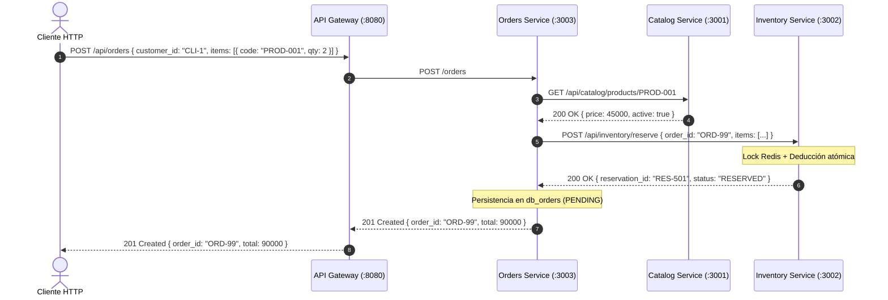

# Diagrama de Arquitectura de Microservicios
**Licenciatura en Sistemas de Información — Programación Distribuida**  
**Universidad Champagnat — TP N° 5**

---

## 1. Diagrama General de Componentes y Persistencia

```mermaid
flowchart TD
    subgraph Clients ["Clientes y Consumidores"]
        Web["Navegador Web / Panel Admin"]
        Mobile["App Móvil / Postman / cURL"]
    end

    subgraph Perimeter ["Capa Perimetral"]
        GW["API Gateway / Reverse Proxy<br/>HTTP :8080<br/>Enrutamiento por prefijo de ruta"]
    end

    subgraph Microservices ["Microservicios Autónomos"]
        
        subgraph SvcCatalog ["Catalog Service (:3001)"]
            CatApp["Catalog Microservice<br/>Node.js + Express<br/>Responsabilidad: Fichas y Precios"]
            CatDB[("MongoDB Propia<br/>db_catalog")]
            CatApp -->|Persistencia Exclusiva| CatDB
        end

        subgraph SvcInventory ["Inventory Service (:3002)"]
            InvApp["Inventory Microservice<br/>Node.js + Express<br/>Responsabilidad: Stock y Reservas"]
            InvDB[("MongoDB Propia<br/>db_inventory")]
            InvRedis[("Redis / Memurai (:6379)<br/>Locks Distribuidos & TTL")]
            InvApp -->|Persistencia Exclusiva| InvDB
            InvApp -->|Locks & Atomics| InvRedis
        end

        subgraph SvcOrders ["Orders Service (:3003)"]
            OrdApp["Orders Microservice<br/>Node.js + Express<br/>Responsabilidad: Pedidos y Checkout"]
            OrdDB[("MongoDB Propia<br/>db_orders")]
            OrdApp -->|Persistencia Exclusiva| OrdDB
        end

    end

    %% Flujos de Clientes a Gateway
    Web -->|HTTP| GW
    Mobile -->|HTTP| GW

    %% Flujos de Gateway a Microservicios
    GW -->|/api/catalog/*| CatApp
    GW -->|/api/inventory/*| InvApp
    GW -->|/api/orders/*| OrdApp

    %% Comunicaciones Inter-Servicio síncronas HTTP REST
    OrdApp -->|HTTP GET /catalog/products/:code<br/>(Consulta precio oficial)| CatApp
    OrdApp -->|HTTP POST /inventory/reserve<br/>(Reserva atómica de stock)| InvApp
    OrdApp -.->|HTTP POST /inventory/confirm<br/>(Deducción definitiva de stock)| InvApp

    classDef serviceNode fill:#e1f5fe,stroke:#0288d1,stroke-width:2px;
    classDef dbNode fill:#e8f5e9,stroke:#388e3c,stroke-width:2px;
    classDef gwNode fill:#fff3e0,stroke:#f57c00,stroke-width:2px;
    class CatApp,InvApp,OrdApp serviceNode;
    class CatDB,InvDB,InvRedis,OrdDB dbNode;
    class GW gwNode;
```

---

## 2. Diagrama de Secuencia: Caso de Uso de Compra y Reserva


