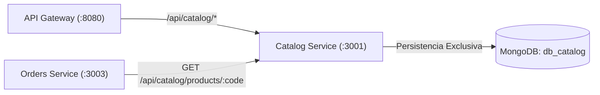

# Catalog Service

**Puerto HTTP:** `3001`  
**Base de Datos:** MongoDB `db_catalog`  
**Responsabilidad:** Gestión comercial y descriptiva de productos, categorías y precios de lista.

## Endpoints Públicos
- `GET /api/catalog/products`: Listado de catálogo comercial.
- `GET /api/catalog/products/:code`: Detalle de producto por código.
- `POST /api/catalog/products`: Creación de nuevo producto.
- `PUT /api/catalog/products/:code`: Actualización de ficha comercial.
- `DELETE /api/catalog/products/:code`: Baja lógica de producto.
- `GET /api/catalog/health`: Chequeo de salud del servicio.

---

## 1. Alcance del Servicio

`Catalog Service` es el único propietario de la información comercial y descriptiva de los productos. Es el único que decide **qué se vende y a qué precio de lista** (ver Sección 8.1, Ficha 1, de [docs/arquitectura.md](../../docs/arquitectura.md)).

### 1.1 Responsabilidades
- Alta, consulta, modificación y baja lógica de productos comerciales.
- Listado de catálogo con filtros por categoría o rango de precios.
- Búsqueda de producto por código único (`codigo`).
- Listado de categorías activas.
- Exposición del precio oficial de lista que consume `Orders Service` al armar una orden.

### 1.2 Datos Propios
| Campo | Descripción |
| :--- | :--- |
| `codigo` | Identificador comercial único, inmutable y normalizado en mayúsculas (ej. `PROD-001`). Es la única clave que comparten los servicios. |
| `nombre` | Nombre comercial del artículo (mínimo 2 caracteres). |
| `precio_base` | Precio de lista; debe ser $\ge 0$. |
| `categoria` | Categoría del artículo (por defecto `"Otros"`). |
| `descripcion` | Ficha descriptiva / especificaciones técnicas. |
| `activo` | Indica si el producto está publicado o fue dado de baja lógicamente. |
| `createdAt`, `updatedAt` | Marcas temporales de trazabilidad. |

### 1.3 Fuera de Alcance
| Responsabilidad | Servicio Propietario | Motivo |
| :--- | :--- | :--- |
| **Stock físico, disponible y reservado** | `Inventory Service` | En el monolito el campo `stock` vivía en el mismo documento `Producto` que los datos descriptivos (Caso 1 de acoplamiento). Esto generaba contención entre las lecturas masivas del catálogo y las escrituras concurrentes de stock, impedía escalar el catálogo de forma independiente y permitía alterar el stock por error al editar una ficha. El catálogo **no guarda ni modifica stock**. |
| **Reservas y exclusión mutua (Redis Lock)** | `Inventory Service` | La sección crítica de reserva es un detalle interno de Inventory (Caso 2 de acoplamiento). Catalog no tiene operaciones que requieran lock distribuido. |
| **Órdenes, carritos, cobros y ventas** | `Orders Service` | El ciclo de vida de una compra responde a reglas comerciales propias (estados, totales, congelamiento del precio). El catálogo solo informa el precio vigente; quien lo fija en la orden es `Orders Service`. |

> **Regla de Oro (Database-per-Service):** ningún otro servicio accede a `db_catalog`. Toda lectura de fichas o precios se hace a través de la API REST de este servicio.

---

## 2. Endpoints y Códigos de Estado

| Método | Ruta | Descripción | Códigos de Estado |
| :---: | :--- | :--- | :--- |
| `GET` | `/api/catalog/products` | Listado de productos activos; admite filtros por categoría o rango de precios. | `200 OK` |
| `GET` | `/api/catalog/products/:code` | Ficha de un producto por código, incluyendo `activo` y precio de lista. | `200 OK` · `400 Bad Request` (código mal formado) · `404 Not Found` (no existe) |
| `POST` | `/api/catalog/products` | Alta de un producto nuevo. | `201 Created` · `400 Bad Request` (datos inválidos) · `409 Conflict` (`codigo` ya existente) |
| `PUT` | `/api/catalog/products/:code` | Modificación de la ficha comercial (nombre, categoría, descripción, precio). | `200 OK` · `400 Bad Request` (código mal formado, datos inválidos o intento de cambiar `codigo`) · `404 Not Found` (no existe) |
| `DELETE` | `/api/catalog/products/:code` | Baja lógica: marca el producto con `activo: false`. | `200 OK` · `400 Bad Request` (código mal formado) · `404 Not Found` (no existe) |
| `GET` | `/api/catalog/categories` | Listado de categorías activas (endpoint nuevo definido en la Ficha 1). | `200 OK` |
| `GET` | `/api/catalog/health` | *Liveness / readiness probe* del servicio y su conexión a `db_catalog`. | `200 OK` · `503 Service Unavailable` (sin conexión a MongoDB) |

Cualquier endpoint puede responder `500 Internal Server Error` ante una falla no controlada.

### 2.1 Distinción entre `400 Bad Request` y `404 Not Found`

Los endpoints que reciben `:code` validan primero el **formato** y recién después consultan la base:

1. **`400 Bad Request` — código mal formado.** El valor recibido no respeta el formato de código de catálogo (`PROD-XXX`, ej. `PROD-001`). La solicitud es inválida en sí misma y **no se consulta `db_catalog`**. El cliente debe corregir la petición antes de reintentar. El código se normaliza a mayúsculas antes de validarlo.
2. **`404 Not Found` — el código no existe.** El formato es correcto pero no hay ningún producto registrado con ese `codigo`. La petición es válida; simplemente el recurso no está.

Esta distinción le permite a `Orders Service` diferenciar un error propio al armar la orden (`400`) de un producto inexistente en el catálogo (`404`, documentado en la Sección 10.1 de la arquitectura).

### 2.2 Baja Lógica en `DELETE`

`DELETE /api/catalog/products/:code` **no elimina el documento** de `db_catalog`: lo marca con `activo: false`. Los motivos son:

- **Integridad histórica de pedidos.** Las órdenes de `Orders Service` referencian productos por `codigo`. Si el producto se borrara físicamente, las órdenes pasadas quedarían apuntando a un código del que ya no se puede recuperar la ficha.
- **Inmutabilidad del `codigo`.** Al conservar el documento, el código no puede reutilizarse para otro artículo, lo que evitaría que una orden vieja termine asociada a un producto distinto.
- **Validación de compras nuevas.** `Orders Service` necesita saber si un producto existe **y está activo** antes de aceptarlo en una orden. Un producto dado de baja sigue existiendo (no devuelve `404`) pero se informa con `activo: false`.

El listado `GET /api/catalog/products` devuelve únicamente productos activos.

---

## 3. Configuración

El servicio se configura con variables de entorno. Copiar [.env.example](.env.example) como `.env` dentro de `services/catalog-service/` y ajustar los valores; el archivo `.env` no se versiona.

| Variable | Valor por Defecto | Descripción |
| :--- | :--- | :--- |
| `NODE_ENV` | `development` | Entorno de ejecución (`development` \| `production`). |
| `HOST` | `127.0.0.1` | Interfaz de red donde escucha el servicio. |
| `PORT` | `3001` | Puerto HTTP del Catalog Service. |
| `API_PREFIX` | `/api/catalog` | Prefijo común de las rutas públicas. |
| `JSON_LIMIT` | `100kb` | Tamaño máximo del cuerpo JSON en `POST` / `PUT`. |
| `MONGODB_URI` | `mongodb://127.0.0.1:27017/db_catalog` | Conexión a la base propia `db_catalog`. |
| `LOG_LEVEL` | `info` | Nivel mínimo de log de Winston. |
| `LOG_MAX_FILES` | `14d` | Retención de los archivos de log rotados. |
| `LOG_MAX_SIZE` | `20m` | Tamaño máximo de cada archivo de log antes de rotar. |

El servicio no configura HTTPS propio: la terminación SSL/TLS se realiza en el API Gateway (Sección 11 de la arquitectura). Tampoco requiere conexión a Redis, porque no maneja locks.

---

## 4. Dependencias con Otros Servicios

`Catalog Service` es un **servicio hoja** (*leaf service*): no realiza llamadas a ningún otro microservicio. Las dependencias son siempre **entrantes**.

| Dirección | Origen | Destino | Motivo | Endpoint |
| :---: | :--- | :--- | :--- | :--- |
| Entrante | **API Gateway** | Catalog Service | Enrutamiento de consultas y administración del catálogo. | `/api/catalog/*` |
| Entrante | **Orders Service** | Catalog Service | Validar existencia y estado activo del producto y obtener el precio oficial al crear una orden. | `GET /api/catalog/products/:code` |
| Saliente | Catalog Service | — | Ninguna. No conoce a `Inventory Service` ni a `Orders Service`. | — |

- **Con `Inventory Service`:** no hay comunicación en ninguna dirección. Ambos servicios comparten únicamente el `codigo` del producto como identificador. Cuando el frontend necesita la ficha junto con la disponibilidad, la composición la hace el API Gateway consultando a los dos servicios (Caso de Uso 2 de la arquitectura).
- **Si `Catalog Service` no está disponible:** `Orders Service` aplica *Fail-Fast* con timeout de 2 segundos y responde `503 Service Unavailable` al cliente (Sección 10.2 de la arquitectura).
